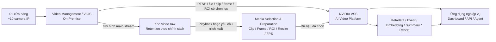
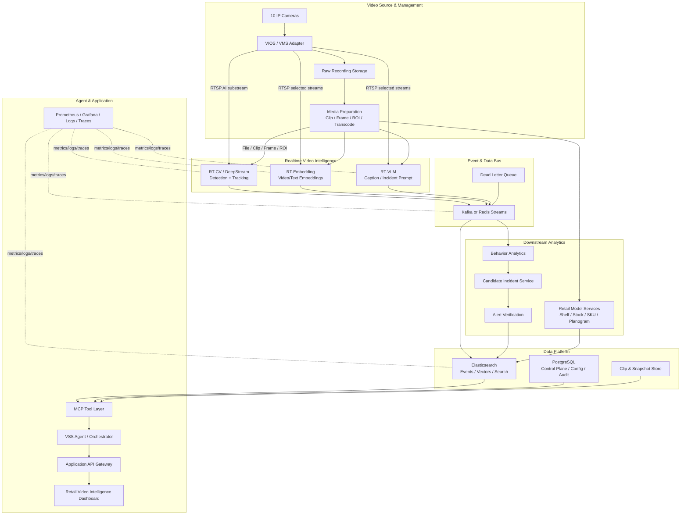
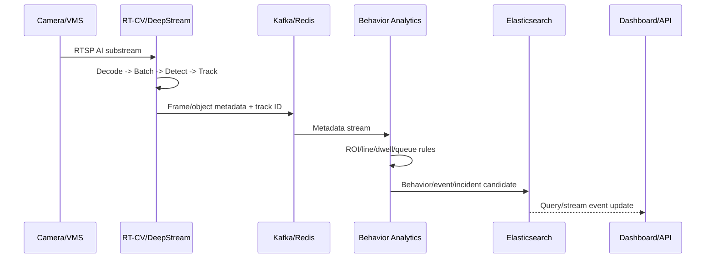
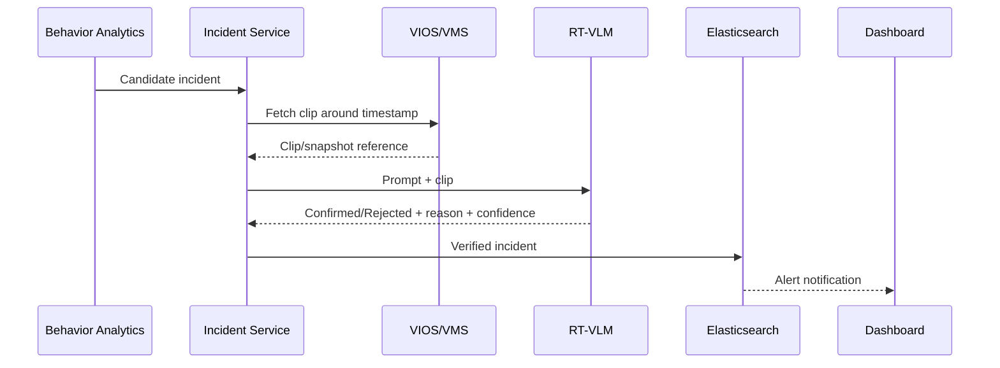
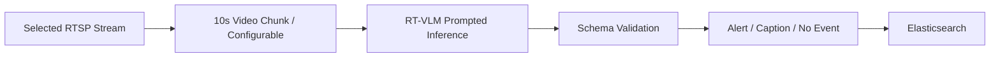
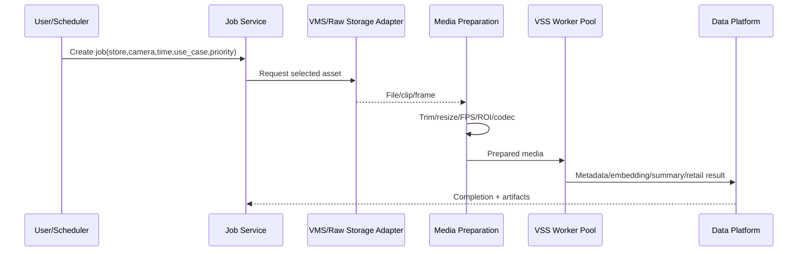
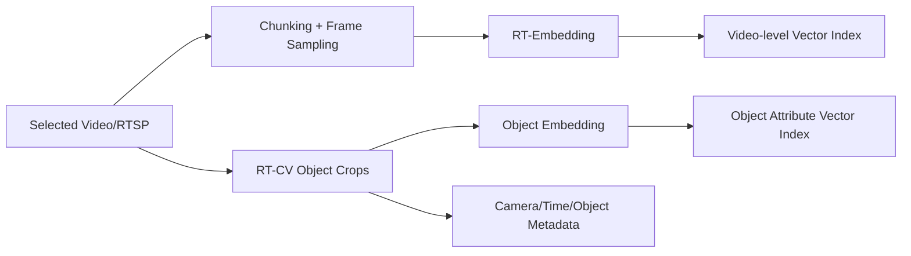
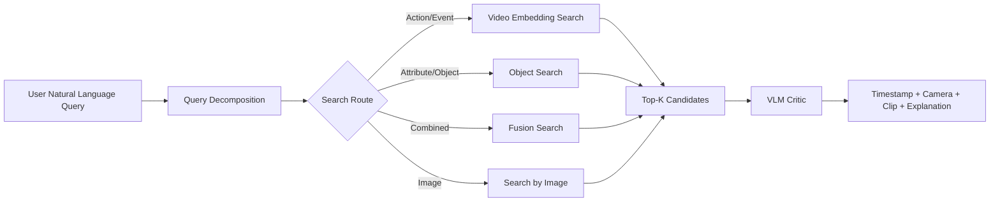
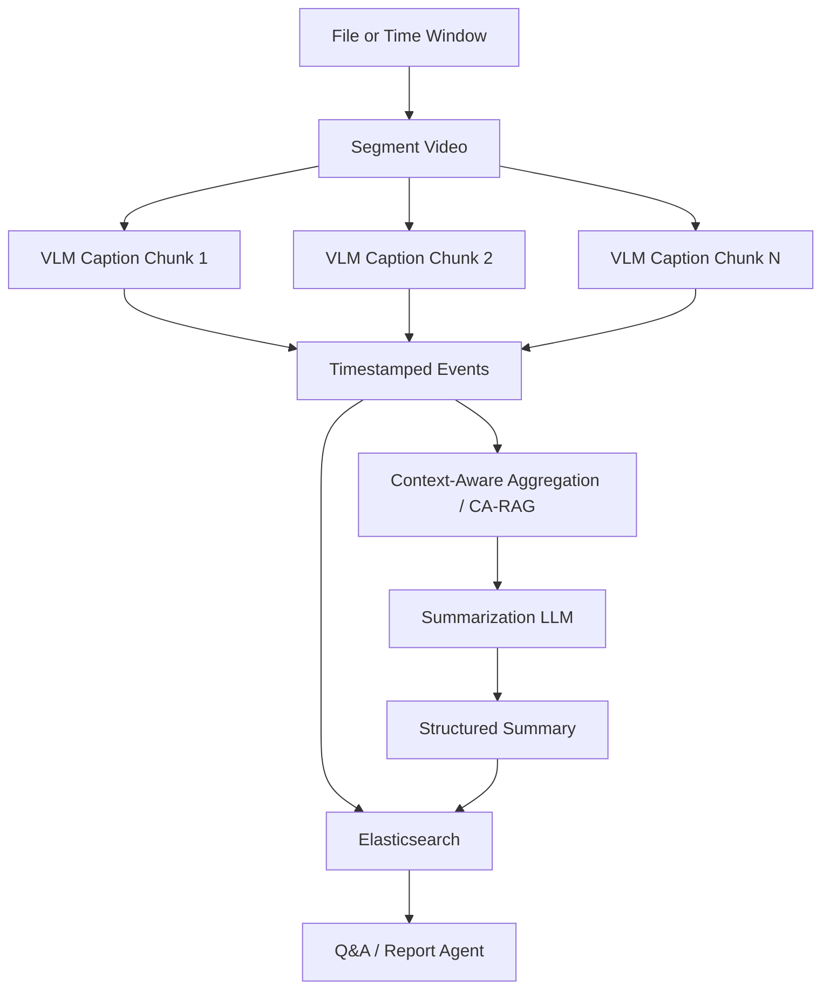
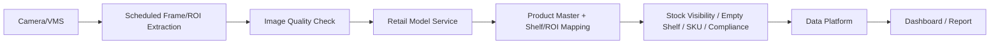

# KẾ HOẠCH TỔNG THỂ DỰ ÁN NVIDIA VSS RETAIL POC

**Phạm vi PoC:** 01 cửa hàng, khoảng 10 camera IP  
**Mục tiêu:** Giữ đầy đủ toàn bộ nhóm tính năng của kiến trúc mục tiêu 3.000 cửa hàng, nhưng thu nhỏ phạm vi dữ liệu, số camera và mức concurrency để kiểm chứng trên một cửa hàng.  
**Phần cứng hiện có:** NVIDIA RTX PRO 5000 Blackwell 48 GB; vẫn phải xác nhận lại bằng `nvidia-smi` trên đúng server.  
**Mô hình triển khai:** On-Premise, không phụ thuộc Public Cloud trong luồng vận hành chính.  
**Phiên bản kế hoạch:** 2.2 — Phased Execution Edition  
**Ngày lập:** 23/07/2026  
**Nguồn thiết kế chính:** tài liệu `DanhGiaMWG(1).docx`, NVIDIA Video Search and Summarization Blueprint và NVIDIA VSS 3.2.1 release assets/documentation và các trang model/NIM chính thức.

---

## 1. Tóm tắt quyết định kiến trúc

PoC này không phải là một bản demo bị cắt bớt tính năng. Đây là **bản triển khai feature-complete ở quy mô một cửa hàng**, trong đó:

- Toàn bộ nhóm năng lực mục tiêu đều phải có đường chạy end-to-end: realtime CV, tracking, behavior analytics, alert verification bằng VLM, RT-VLM alert, video embedding/search, long-video summarization, Q&A/report, offline/batch, stock/empty shelf, planogram/SKU, dashboard/API, observability, security và audit.
- Phần bị thu nhỏ chỉ là:
  - 01 cửa hàng thay vì 3.000 cửa hàng.
  - Khoảng 10 camera thay vì 30.000 camera.
  - Concurrency và throughput được giới hạn theo năng lực thực tế của một RTX PRO 5000 Blackwell.
  - Các GPU-heavy workload được điều phối theo profile và hàng đợi, thay vì bắt buộc tất cả model lớn chạy cực đại cùng lúc.
- Video raw và AI là hai lớp độc lập:
  - Hệ thống video/VMS/VIOS chịu trách nhiệm nhận camera, ghi hình, playback và trích clip/frame.
  - NVIDIA VSS nhận **RTSP, file, clip, frame hoặc ROI có chọn lọc** để xử lý AI.
  - `Metadata / Event / Embedding / Report` là đầu ra do VSS và các model service sinh ra.
  - **Không có luồng trực tiếp từ “Kho video raw” sang “Metadata / Event / Embedding / Report”.** Dữ liệu lịch sử phải đi qua lớp chọn nguồn/trích xuất media rồi mới vào VSS.
- RTX PRO 5000 Blackwell hiện không nằm trong danh sách GPU đã được NVIDIA xác nhận đầy đủ cho VSS 3.2.1. Vì vậy PoC phải chạy theo cấu hình `OTHER/experimental`, benchmark từ thấp lên cao và không được suy diễn hiệu năng từ H100 hoặc RTX PRO 6000.
- Mọi model, cache, virtual environment, dữ liệu runtime, index, log và build cache do dự án tạo ra phải nằm trong thư mục project hoặc volume bind vào project.
- Không được tự động xóa Docker image cũ, Docker volume cũ hoặc build cache cũ. Không đưa lệnh prune vào script mặc định.

---


## 1.1. Chốt kỹ thuật mới nhất: release, model, NIM và topology

### Release phải dùng

- **Git/release baseline:** NVIDIA VSS **3.2.1**.
- Dùng đúng release branch/tag và deployment assets của 3.2.1.
- Không tự đổi toàn bộ container sang tag `3.2.1`; release 3.2.1 có thể cố ý dùng hỗn hợp tag 3.2.1 và các tag 3.2.0 không thay đổi.
- Sau lần pull đầu tiên, ghi lại **image digest** và model artifact version vào `artifacts/manifests/`.
- Không dùng image 2.x, 3.0 hoặc 3.1 cho project mới.

### Chốt model/NIM chính

| Vai trò | Chọn chính thức cho PoC | Serving/runtime | Trạng thái |
|---|---|---|---|
| LLM Agent | `nvidia/nvidia-nemotron-nano-9b-v2` | NVIDIA NIM, OpenAI-compatible API | Bắt buộc |
| VLM/critic/visual reasoning | `nvidia/cosmos3-nano-reasoner` | NVIDIA NIM hoặc VSS RT-VLM | Bắt buộc |
| RT-CV detector | RT-DETR Warehouse 2D v1.0.2, ResNet-50, 640×640, FP16 | DeepStream + TensorRT | Bắt buộc baseline |
| Tracker | NvDCF tracker | DeepStream | Bắt buộc |
| Video/action embedding | `Cosmos-Embed1-448p-anomaly-detection`, FP16, TensorRT | VSS RT-Embedding | Bắt buộc |
| Object/attribute embedding | SigLIP2; PoC pin `siglip2-so400m-patch16-256`, FP16 | RT-CV vision encoder | Bắt buộc cho attribute/image search |
| Retail baseline | RT-DETR + SigLIP2 + ROI rules + Cosmos3 verification | Batch/event-driven | Bắt buộc |
| Retail production candidate | Custom TAO RT-DETR/embedding model từ dữ liệu cửa hàng | ONNX/TensorRT/Triton hoặc DeepStream | Sau baseline/evaluation |

### Không tải mặc định

- Không tải cả Cosmos Reason2 8B và Cosmos3 Nano chỉ để “phòng hờ”.
- Không tải Sparse4D/MV3DT trong PoC 2D một cửa hàng nếu chưa có yêu cầu 3D multi-camera, camera calibration và vùng nhìn chồng lấn.
- Không tải face recognition model.
- Không tải model SKU từ nguồn không rõ license.
- Không tải nhiều checkpoint/resolution của Cosmos-Embed cùng lúc.
- Không dùng tag `latest` làm cấu hình vận hành lâu dài; `latest` chỉ được phép dùng để discovery ban đầu, sau đó pin digest.

### Kết luận topology cho một GPU 48 GB

Một RTX PRO 5000 Blackwell 48 GB **không phải topology VSS đã được NVIDIA validate** và cũng không đủ để chạy stock Search profile full-local theo cấu hình chính thức. Search profile chính thức dùng hai base GPU ngay cả khi LLM/VLM ở remote endpoint.

Vì vậy project phải có hai mode:

1. **`poc-single-gpu-local-serialized` — mode bắt buộc để chứng minh local**
   - Tất cả model được tải/cache local.
   - RT-CV là workload ưu tiên.
   - RT-Embed, VLM, LLM và retail batch chạy theo admission control/mutual exclusion.
   - Feature đầy đủ nhưng không cam kết mọi GPU-heavy feature chạy peak đồng thời.

2. **`poc-feature-complete-online` — mode khuyến nghị để demo đầy đủ đồng thời**
   - RT-CV/RT-Embed/VIOS chạy local.
   - LLM/VLM dùng endpoint NIM ở máy GPU khác trong LAN hoặc NVIDIA-hosted endpoint nếu chính sách cho phép.
   - Dashboard/API/search/alert/summarization luôn khả dụng.
   - Khi có thêm GPU, chuyển endpoint về on-prem mà không đổi application API.

Agent không được che giấu giới hạn này và không được tuyên bố “full stack one-GPU đã được NVIDIA support”.

---

## 2. Mục tiêu của PoC

### 2.1. Mục tiêu nghiệp vụ

PoC phải chứng minh một cửa hàng có thể sử dụng một nền tảng AI Video Intelligence thống nhất để:

1. Theo dõi lưu lượng người và hành vi trong cửa hàng gần realtime.
2. Phát hiện các sự kiện vận hành cần chú ý.
3. Tìm kiếm lại video bằng ngôn ngữ tự nhiên.
4. Tóm tắt video hoặc khoảng thời gian dài.
5. Tạo báo cáo theo camera, khu vực, ca và loại sự kiện.
6. Phân tích kệ hàng, stock visibility, empty shelf, planogram và SKU ở chế độ định kỳ/offline.
7. Cho phép người dùng truy vấn thông qua dashboard, API và agent.
8. Đo được hiệu năng, độ chính xác, độ ổn định và chi phí tài nguyên để làm cơ sở scale lên pilot nhiều cửa hàng.

### 2.2. Mục tiêu kỹ thuật

PoC phải trả lời được các câu hỏi sau:

- RTX PRO 5000 Blackwell có đúng 48 GB VRAM như cấu hình sản phẩm, driver và decoder có hoạt động đúng trong container không?
- GPU này chạy ổn định bao nhiêu RTSP stream với đúng resolution, codec, FPS, model và tracker thực tế?
- 10 camera có thể duy trì RT-CV liên tục ở 5–10 FPS không?
- Khi bật alert verification, search indexing, VLM captioning hoặc summarization thì VRAM, utilization và latency thay đổi như thế nào?
- Các GPU-heavy workload nào có thể chạy đồng thời, workload nào cần xếp lịch hoặc tạm dừng workload batch?
- Pipeline offline xử lý nhanh hơn hay chậm hơn thời lượng video thật?
- Search có tìm đúng clip, timestamp và camera không?
- VLM có làm giảm false alert so với rule/CV thuần không?
- Stock/empty shelf/planogram cần bao nhiêu dữ liệu thực tế để đạt mức chính xác chấp nhận được?
- Hệ thống có chịu được RTSP disconnect, service restart, broker lag, Elasticsearch restart và GPU OOM không?
- Dữ liệu, model, cache và log có được giữ đúng trong project directory không?
- Mọi bước có tái lập được bằng script và tài liệu không?

---

## 3. Phạm vi tính năng bắt buộc

### 3.1. Feature matrix

| Nhóm | Tính năng phải có trong PoC | Chế độ | Ghi chú triển khai ở quy mô 10 camera |
|---|---|---|---|
| Camera/VMS | Đăng ký 10 camera, RTSP health, reconnect, recording, playback | Realtime | Tất cả camera phải được quản lý tập trung |
| Video ingest | RTSP main stream và AI substream | Realtime | Ưu tiên substream cho AI, main stream cho lưu trữ |
| RT-CV | Detection, tracking, bounding box, track ID | Realtime | Chạy trên camera trọng điểm hoặc toàn bộ 10 camera tùy benchmark |
| Behavior analytics | Line crossing, ROI entry/exit, dwell time, restricted zone, queue | Realtime | Rule cấu hình theo từng camera |
| People counting | In/out count và occupancy | Realtime | Cần calibration line/ROI |
| Queue detection | Số người, chiều dài hàng, thời gian chờ ước tính | Realtime | Chỉ camera quầy thanh toán |
| Heatmap | Heatmap gần realtime và tổng hợp theo ca/ngày | Realtime + Offline | Metadata-based, không cần giữ frame trong index |
| Alert candidate | Sinh incident từ CV/rule | Realtime | Candidate phải có camera và timestamp |
| Alert verification | VLM xác minh candidate clip | Event-driven | Không chạy VLM 24/7 trên mọi camera |
| RT-VLM alert | Prompt-defined alert trực tiếp từ stream | Realtime có kiểm soát | Bật cho 1–2 camera/use case để đo tải, feature vẫn tồn tại đầy đủ |
| RT-Embedding | Embedding từ RTSP, file, image và text | Realtime + Batch | Dùng cho action/event search |
| Object embedding | Embedding crop object từ RT-CV | Realtime | Dùng cho attribute/image search nếu profile hỗ trợ |
| Video search | Action, event, object attribute, fusion, search by image | On-demand | Có timestamp, camera, clip và score |
| Critic verification | VLM review candidate search result | On-demand | Chỉ chạy top-K candidate |
| Long-video summarization | Chunk, caption, aggregation, final summary | Offline + Stream window | Hỗ trợ file và time window |
| Video Q&A | Hỏi đáp theo video, stream, time range | On-demand | Câu trả lời phải kèm evidence/timestamp |
| Agent/MCP | Tool orchestration cho search, clip, alert, summary, report | On-demand | Không expose MCP trực tiếp ra Internet |
| Reporting | Incident report, shift report, daily report | Batch + On-demand | Xuất JSON/Markdown/PDF sau này; PoC bắt buộc JSON/Markdown |
| Stock visibility | Nhìn thấy hàng trên kệ | Offline định kỳ | Không thay thế ERP/POS/WMS |
| Empty shelf | Phát hiện vùng kệ trống | Offline định kỳ | Frame/ROI mỗi 1–5 phút |
| Planogram | Đúng/sai vị trí sản phẩm | Offline định kỳ | Cần product master và layout chuẩn |
| SKU | Nhận diện/đối sánh SKU | Offline định kỳ | Custom model hoặc embedding + classifier |
| Scheduler | Priority queue, concurrency, retry, dead-letter | Offline + Event-driven | Bắt buộc vì chỉ có một GPU |
| Dashboard | Live wall, camera, event, alert, search, summary, jobs, health | Web | Một giao diện thống nhất |
| API | Camera, events, search, summary, report, jobs, configuration | REST/SSE | API nội bộ ổn định, che giấu API vendor |
| Observability | GPU, stream, queue, model, API, database, tracing | Toàn hệ thống | Có dashboard và alert kỹ thuật |
| Security | TLS, authentication, RBAC, secret management, audit | Toàn hệ thống | VSS chạy trong trusted network |
| Data governance | Retention, masking, access log, deletion workflow | Toàn hệ thống | Cấu hình được theo camera/use case |

### 3.2. Những nội dung không được hiểu là “cắt tính năng”

Các quyết định sau chỉ là giới hạn tài nguyên PoC:

- RT-VLM continuous có thể chỉ bật trên 1–2 camera tại một thời điểm.
- Search indexing và summarization có thể chạy theo khung giờ hoặc priority queue.
- Retail model có thể chạy frame/ROI định kỳ thay vì stream 30 FPS.
- Một số model lớn có thể phải unload/reload khi chuyển profile trên bản 48 GB.
- Tất cả API, UI, workflow và schema vẫn phải được triển khai đầy đủ.

---

## 4. Kiến trúc tổng thể

### 4.1. Sơ đồ logic chính xác



**Quy tắc bắt buộc:**

- Không nối trực tiếp `RAW -> OUT`.
- Raw storage chỉ cung cấp dữ liệu cho lớp media selection/preparation khi có job hoặc truy vấn.
- Metadata/event/embedding/summary/report phải được sinh bởi VSS hoặc model service đã tích hợp vào VSS.
- VSS không lưu thêm một bản sao đầy đủ của toàn bộ video raw.

### 4.2. Sơ đồ thành phần chi tiết



---

## 5. Các pipeline end-to-end

## 5.1. Pipeline realtime CV



### Input

- RTSP H.264/H.265.
- Ưu tiên AI substream 720p hoặc 1080p.
- Target ban đầu: 5 FPS, sau đó 10 FPS nếu GPU còn headroom.
- Main stream vẫn được ghi độc lập bởi VMS/VIOS.

### Output

- Detection: class, confidence, bounding box.
- Tracking: track ID, trajectory, duration.
- Behavior: line crossing, zone entry/exit, dwell, queue state.
- Event/incident: camera ID, start/end timestamp, evidence reference.
- Metrics: frame rate, dropped frames, inference latency, reconnect count.

### Yêu cầu implementation

- Mỗi camera có source ID ổn định, không dùng index tạm thời làm định danh.
- Timestamp phải chuẩn UTC trong backend; UI hiển thị timezone cấu hình.
- Tất cả event handler phải idempotent.
- Dedupe key đề xuất: `store_id + camera_id + event_type + track_id + time_bucket`.
- Cấu hình line/ROI lưu trong PostgreSQL và version hóa.
- Có cơ chế warm restart để không làm mất toàn bộ cấu hình camera.

---

## 5.2. Pipeline alert verification



### Nguyên tắc

- CV/rule là bộ lọc nhanh.
- Chỉ candidate quan trọng mới gọi VLM.
- Clip nên có pre-roll và post-roll để VLM không mất ngữ cảnh.
- Prompt phải trả schema JSON cố định, ví dụ:

```json
{
  "verdict": "confirmed|rejected|uncertain",
  "event_type": "restricted_zone",
  "reason": "...",
  "evidence_start": "...",
  "evidence_end": "...",
  "confidence": 0.0
}
```

### Cơ chế chống lỗi

- JSON schema validation.
- Retry một lần với repair prompt nếu output sai schema.
- Nếu vẫn sai: lưu `uncertain`, không tự động coi là confirmed.
- Clip fetch timeout phải tách khỏi VLM timeout.
- Có dead-letter queue cho incident không xác minh được.

---

## 5.3. Pipeline RT-VLM alert trực tiếp



### Use case PoC

- Chỉ bật 1–2 camera tại một thời điểm.
- Chọn 1–2 sự kiện khó viết rule, ví dụ:
  - Vật thể bị bỏ quên.
  - Hành vi thao tác bất thường tại khu vực quầy.
  - Một người ngã hoặc cần hỗ trợ.
- Đây là profile benchmark, không thay thế RT-CV toàn bộ cửa hàng.

### KPI

- Chunk processing latency.
- Số stream đồng thời.
- GPU utilization và VRAM peak.
- False positive/false negative trên tập clip đã gán nhãn.
- Số alert/phút và backpressure.

---

## 5.4. Pipeline offline/batch



### Job types

- `retail_frame_analysis`
- `historical_heatmap`
- `video_indexing`
- `video_summarization`
- `incident_investigation`
- `daily_report`
- `reprocess_failed_asset`

### Priority

1. Realtime safety/operational incident.
2. User-triggered investigation/search.
3. Alert verification.
4. Scheduled retail frame analysis.
5. Search indexing.
6. Long-video summarization/report.
7. Backfill/reprocessing.

### Bắt buộc

- Priority queue.
- Per-job retry policy.
- Concurrency limit theo GPU profile.
- Queue age metric.
- Cancellation.
- Idempotency key.
- Dead-letter queue.
- Resume/checkpoint với video dài.

---

## 5.5. Pipeline video search

### Giai đoạn indexing



### Giai đoạn query



### Các route bắt buộc

- Action/event search.
- Object attribute search.
- Multi-embedding fusion search.
- Search by image/crop.
- Metadata filter: store, camera, time range, zone, event type.
- Critic VLM review top-K.

### Search result contract

```json
{
  "query": "...",
  "results": [
    {
      "camera_id": "cam-01",
      "start_time": "...",
      "end_time": "...",
      "clip_url": "...",
      "thumbnail_url": "...",
      "retrieval_score": 0.0,
      "critic_verdict": "relevant|not_relevant|uncertain",
      "explanation": "..."
    }
  ]
}
```

---

## 5.6. Pipeline long-video summarization, Q&A và report



### Output tối thiểu

- Timeline sự kiện có timestamp.
- Executive summary.
- Danh sách incident quan trọng.
- Người/vật thể/hành động đáng chú ý.
- Khoảng thời gian không có sự kiện.
- Evidence links.
- Structured JSON và Markdown report.

### Q&A guardrails

- Chỉ trả lời dựa trên event/caption/clip đã truy xuất.
- Không có evidence thì trả `không đủ dữ liệu`.
- Câu trả lời phải trả camera và timestamp.
- Với câu hỏi quan trọng, Agent phải mở clip và gọi VLM verification thay vì chỉ tin caption cũ.

---

## 5.7. Pipeline retail stock, empty shelf, planogram và SKU



### Thiết kế bắt buộc

- Không kéo toàn bộ video 25–30 FPS để kiểm tra kệ.
- Mặc định lấy 1 frame/ROI mỗi 1–5 phút, cấu hình theo khu vực.
- Có quality gate để bỏ frame mờ, tối, bị che hoặc camera lệch.
- Product master chứa:
  - SKU ID.
  - Tên sản phẩm.
  - Brand/category.
  - Reference image/embedding.
  - Shelf/planogram position.
- Camera-to-shelf mapping và ROI phải version hóa.
- Kết quả camera chỉ là `visual stock visibility`, không phải số tồn kho chính thức.
- Thiết kế sẵn adapter để nối POS/ERP/WMS trong giai đoạn pilot.

### Lộ trình model retail

1. Baseline bằng detector/embedding có sẵn.
2. Thu thập và gán nhãn dữ liệu thật.
3. Fine-tune model chuyên biệt.
4. Export ONNX/TensorRT.
5. Serve qua Triton hoặc tích hợp DeepStream.
6. A/B compare baseline và model fine-tune.

---

## 6. Thiết kế triển khai trên RTX PRO 5000 Blackwell

## 6.1. Cảnh báo tương thích

RTX PRO 5000 Blackwell không nằm trong danh sách GPU đã được NVIDIA VSS 3.2.1 xác nhận đầy đủ. Kế hoạch phải coi đây là **platform experimental**:

- Dùng tab/config `OTHER` nếu workflow NVIDIA yêu cầu chọn GPU profile.
- Không copy benchmark H100/RTX PRO 6000 để cam kết throughput.
- Bắt đầu 1 stream, sau đó tăng 2 → 4 → 6 → 8 → 10.
- Mỗi mức tải chạy tối thiểu 30–60 phút; tải mục tiêu chạy soak 24–72 giờ.
- Theo dõi decode utilization riêng, không chỉ nhìn GPU utilization.

## 6.2. Preflight bắt buộc

Chạy và lưu output vào `artifacts/preflight/`:

```bash
nvidia-smi --query-gpu=name,memory.total,driver_version,pci.bus_id --format=csv
nvidia-smi -q
nvidia-ctk cdi list
uname -a
lsb_release -a
docker version
docker compose version
```

Kết quả phải xác định rõ:

- GPU có đúng 48 GB VRAM.
- OS Ubuntu 22.04 hoặc 24.04.
- Driver 580.x tương thích yêu cầu VSS hiện tại.
- NVIDIA Container Toolkit hoạt động.
- Container nhìn thấy GPU và NVDEC.
- Disk đủ cho image, model, raw sample, Elasticsearch và log.

## 6.3. Nguyên tắc feature-complete trên một GPU

Một GPU không bắt buộc chạy mọi model lớn ở peak load đồng thời. Dùng mô hình:

- Control-plane service luôn chạy.
- Realtime core có ưu tiên cao nhất.
- GPU-heavy worker được bật theo profile và queue.
- Batch job có thể pause khi có incident hoặc user query ưu tiên.
- Model có thể unload/reload nếu VRAM không đủ.
- Tất cả tính năng vẫn có endpoint, UI, job type và test case đầy đủ.

## 6.4. Runtime profiles

| Profile | Service GPU chính | Mục đích | Cách chạy PoC |
|---|---|---|---|
| `infra` | Không/ít GPU | PostgreSQL, Kafka, ES, API, UI, observability | Luôn chạy |
| `realtime-core` | RT-CV | Detection, tracking, behavior | Ưu tiên cao, 5–10 FPS |
| `alert-verify` | RT-VLM | Verify candidate clip | Event-driven |
| `rt-vlm-alert` | RT-VLM | Prompt alert trực tiếp | 1–2 stream để benchmark |
| `search-index` | RT-Embedding | Index video/object | Theo lịch/queue |
| `search-query` | Embed + critic VLM | Query và rerank | On-demand |
| `summarization` | RT-VLM + LLM | Caption và summary | Batch/on-demand |
| `retail-batch` | Retail model | Shelf/SKU/planogram | Frame định kỳ |
| `full-demo` | Tất cả logical service | Demo tích hợp | Heavy worker được admission controller điều phối, không phải peak concurrency |

## 6.5. Chính sách admission control

Tạo service `gpu-admission-controller`:

- Đọc VRAM free, GPU utilization, active model và queue priority.
- Không start job nếu VRAM headroom thấp hơn ngưỡng cấu hình.
- Không chạy summarization dài khi alert verification backlog vượt ngưỡng.
- Cho phép preempt batch job tại checkpoint.
- RTX PRO 5000 Blackwell 48 GB phải dùng chính sách mutual exclusion nghiêm ngặt giữa VLM lớn, RT-Embedding và retail batch cho đến khi benchmark chứng minh có thể overlap an toàn.

Pseudo policy:

```yaml
priority:
  realtime_cv: 100
  alert_verification: 90
  user_search: 80
  rt_vlm_alert: 75
  retail_frame: 60
  summarization: 50
  search_backfill: 40

rules:
  - when: alert_backlog > 0
    pause: [summarization, search_backfill]
  - when: gpu_memory_free_percent < 15
    reject_new_gpu_jobs: true
  - when: realtime_frame_drop_percent > 2
    throttle: [search_index, retail_frame]
```

---


## 6.6. Chốt release VSS và artifact policy

### Release pin

```text
VSS_RELEASE=3.2.1
VSS_GIT_REF=v3.2.1 hoặc branch/release ref chính thức tương ứng
```

Quy tắc:

- Clone VSS vào `third_party/video-search-and-summarization/`.
- Không sửa trực tiếp upstream source nếu chưa cần; custom code đặt ở `overlays/`, `services/` hoặc patch có version.
- Lưu commit SHA thực tế vào `artifacts/manifests/vss-git-revision.txt`.
- Dùng `docker compose config` tạo `artifacts/manifests/resolved-compose.yml`.
- Lưu image digest trước và sau deploy.
- 3.2.1 là bug-fix release; deployment assets có thể tham chiếu image 3.2.0 không đổi. Agent phải tôn trọng manifest, không “nâng tag cho đồng bộ” bằng phỏng đoán.

## 6.7. Model manifest bắt buộc

Tạo file `config/models/model-manifest.yaml`:

```yaml
schema_version: 1

release:
  vss: "3.2.1"

llm:
  id: "nvidia/nvidia-nemotron-nano-9b-v2"
  serving: "nim"
  image_discovery: "nvcr.io/nim/nvidia/nvidia-nemotron-nano-9b-v2:latest"
  port: 30081
  cache_dir: ".cache/nim/nemotron-nano-9b-v2"
  pin_after_pull: true
  required: true

vlm:
  id: "nvidia/cosmos3-nano-reasoner"
  serving: "nim_or_rt_vlm"
  image_discovery: "nvcr.io/nim/nvidia/cosmos3-reasoner:latest"
  vss_model_path: "ngc:nim/nvidia/cosmos3-nano-reasoner:bf16-final"
  port: 30082
  cache_dir: ".cache/nim/cosmos3-nano-reasoner"
  pin_after_pull: true
  required: true

rt_cv:
  container_family: "nvcr.io/nvidia/vss-core/vss-rt-cv"
  release_asset_managed: true
  detector:
    family: "RT-DETR Warehouse 2D"
    version: "1.0.2"
    backbone: "ResNet-50"
    input: [640, 640]
    precision: "fp16"
    initial_classes: ["Person"]
  tracker:
    type: "NvDCF"

rt_embed:
  container_family: "nvcr.io/nvidia/vss-core/vss-rt-embed"
  release_asset_managed: true
  model: "Cosmos-Embed1-448p-anomaly-detection"
  resolution: [448, 448]
  frames_per_chunk: 8
  chunk_seconds: 10
  embedding_dim: 768
  precision: "fp16"

object_embedding:
  model: "siglip2-so400m-patch16-256"
  resolution: [256, 256]
  precision: "fp16"
  usage: ["attribute_search", "search_by_image", "sku_similarity"]

retail:
  baseline:
    detector: "RT-DETR v1.0.2"
    embedder: "SigLIP2 SO400M 256"
    verifier: "Cosmos3 Nano Reasoner"
  custom_model:
    status: "not-trained"
    framework: "NVIDIA TAO RT-DETR or compatible PyTorch"
    export: ["ONNX", "TensorRT"]
```

Agent phải cập nhật thêm:

- Image digest.
- NIM profile ID đã auto-select.
- Model SHA256 nếu có local artifact.
- Ngày tải.
- License/source.
- GPU dùng để build TensorRT engine.
- TensorRT/CUDA/driver version.

## 6.8. Vì sao chọn từng model

### Nemotron Nano 9B v2

Dùng cho:

- Intent classification.
- Query decomposition.
- Tool selection.
- MCP orchestration.
- Search fusion planning.
- Tổng hợp summary/report.
- Q&A dựa trên evidence.

Không dùng để:

- Detect vật thể trực tiếp.
- Xem pixel/video trực tiếp.
- Tạo embedding video.
- Thay detector/tracker.

Cấu hình PoC:

```yaml
temperature: 0.2
top_p: 0.9
max_tokens: 2048
reasoning:
  enabled_for:
    - query_decomposition
    - report_generation
  disabled_or_small_budget_for:
    - simple_routing
    - status_queries
```

Prompt/tool schema ưu tiên tiếng Anh nội bộ để ổn định. UI có thể nhận tiếng Việt nhưng phải có evaluation riêng vì tiếng Việt không nên được mặc định xem là đã validate.

### Cosmos3 Nano Reasoner

Dùng cho:

- Search critic.
- Alert verification.
- Clip caption.
- Visual Q&A.
- RT-VLM prompt alert.
- Empty-shelf/planogram verification trên ROI.
- Evidence extraction có timestamp.

Lý do chọn:

- VSS 3.2.1 cập nhật Cosmos Reason 3 Nano thành default VLM.
- Nhẹ hơn Cosmos Reason 3 Super.
- Phù hợp hơn với PoC một GPU có admission control.

Quy tắc:

- Không chạy continuous trên 10 camera.
- RT-VLM continuous chỉ 1–2 camera trong benchmark.
- Alert verification chạy event-driven.
- Search critic chỉ xem top-K.
- Summarization xử lý chunk theo queue.
- Output bắt buộc JSON schema hoặc structured response.

### RT-DETR Warehouse 2D v1.0.2

Dùng cho:

- Person detection.
- People counting.
- Queue.
- Dwell time.
- Restricted zone.
- Candidate event.
- Crop object cho SigLIP2.

Giới hạn:

- Pretrained warehouse classes không phải retail SKU.
- PoC ban đầu chỉ tin cậy class `Person` sau evaluation.
- Forklift/pallet không có giá trị chính cho cửa hàng bán lẻ.
- Stock/SKU/planogram cần dữ liệu thật và fine-tune.

Cấu hình khởi đầu:

```yaml
input_resolution: 640x640
precision: fp16
target_ai_fps: 5
max_target_ai_fps: 10
confidence_threshold: 0.45
nms_iou_threshold: 0.5
tracker: NvDCF
```

Threshold chỉ là baseline; phải tune theo camera thật.

### Cosmos-Embed1-448p-anomaly-detection

Dùng cho:

- Action/event embedding.
- Text-to-video retrieval.
- Video archive search.
- Search fusion.

Cấu hình VSS 3.2:

- 8 frame/10 giây.
- 448×448.
- Vector 768 chiều.
- FP16 TensorRT.

Không tự hạ sang 224p chỉ để giảm tải nếu chưa đo search quality. Nếu 448p không ổn trên RTX PRO 5000, agent phải benchmark 336p/224p như một experiment riêng và re-index toàn bộ dữ liệu khi đổi model/dimension/semantics.

### SigLIP2 SO400M patch16 256

Dùng cho:

- Object attribute embedding.
- Search by image.
- Similarity giữa crop sản phẩm.
- Baseline SKU matching.
- Appearance-based re-identification trong phạm vi PoC.

Đây là lựa chọn PoC ưu tiên compute/memory. Nếu accuracy không đạt, đánh giá variant lớn hơn sau, nhưng không tải nhiều variant trước khi có benchmark.

## 6.9. Retail AI feature-complete nhưng không giả model “có sẵn”

### Empty shelf

Baseline:

1. Cắt ROI kệ.
2. Quality gate: blur, glare, occlusion, camera shifted.
3. So sánh occupancy/visual features với reference.
4. VLM verify trường hợp nghi ngờ.
5. Trả `empty`, `partially_empty`, `unknown`, `not_evaluable`.

### Stock visibility

- Chỉ trả visual availability/visibility.
- Không trả số tồn kho chính thức.
- Kết hợp product master và mapping shelf.
- Adapter POS/ERP/WMS để sẵn nhưng không bắt buộc kết nối ở PoC.

### Planogram

- Reference planogram được version hóa.
- Chia shelf thành slot.
- SigLIP2 matching theo slot.
- VLM verify mismatch top candidates.
- Trả confidence và evidence image.

### SKU

Baseline:

- Product reference image embeddings bằng SigLIP2.
- Candidate retrieval top-K.
- VLM/logic verification.
- `unknown_sku` là output hợp lệ.
- Không ép classifier đoán khi confidence thấp.

Custom model chỉ bắt đầu sau khi có:

- Dữ liệu camera thật.
- Product master.
- Annotation guideline.
- Tập train/val/test tách theo cửa hàng/camera/thời gian.
- KPI business được chốt.

## 6.10. Project-local environment: hiểu đúng “venv”

**NIM là Docker container, không thể được cài “bên trong Python venv” theo nghĩa thông thường.**

Quy tắc đúng:

- Python CLI/SDK/script chạy trong `PROJECT_ROOT/.venv`.
- Model weights/cache của NIM bind-mount vào thư mục project.
- Hugging Face/TAO/TensorRT cache nằm trong project.
- Docker image layer vẫn thuộc Docker daemon của host ở mode `host-docker-safe`.
- Không đổi Docker `data-root` của host và không xóa image cũ.
- Nếu cần image layer cũng nằm trong project thì phải dùng project-specific daemon/rootless mode sau khi GPU CDI test pass.

Cấu trúc bắt buộc:

```text
PROJECT_ROOT/
├── .venv/
├── .cache/
│   ├── nim/
│   │   ├── nemotron-nano-9b-v2/
│   │   └── cosmos3-nano-reasoner/
│   ├── ngc/
│   ├── huggingface/
│   ├── torch/
│   ├── triton/
│   ├── tensorrt/
│   ├── pip/
│   ├── uv/
│   ├── buildkit/
│   └── tmp/
├── models/
│   ├── rtdetr/
│   ├── siglip2/
│   ├── cosmos-embed1/
│   └── retail-custom/
├── runtime/
│   ├── vss/
│   ├── vios/
│   ├── elasticsearch/
│   ├── postgres/
│   ├── kafka/
│   ├── redis/
│   ├── clips/
│   └── logs/
├── artifacts/
│   ├── manifests/
│   ├── preflight/
│   ├── benchmarks/
│   └── evals/
└── .secrets/
```

`.secrets/`, `.cache/`, `runtime/`, `.venv/` phải nằm trong `.gitignore`.

## 6.11. API key policy

Server đã có `NGC_API_KEY` trong shell environment. Project phải:

- Không ghi giá trị key vào plan.
- Không echo key.
- Không commit key.
- Không thêm lại lệnh `export NGC_API_KEY=...`.
- Chỉ kiểm tra biến đã tồn tại.
- Truyền vào container bằng `-e NGC_API_KEY`.
- Đăng nhập registry qua stdin.
- Nếu chạy từ non-interactive shell, operator phải bảo đảm environment đã được load trước khi chạy script.

Preflight:

```bash
if [[ -z "${NGC_API_KEY:-}" ]]; then
  echo "ERROR: NGC_API_KEY is not loaded in the current shell."
  echo "Open a login shell or source the operator-approved environment, then retry."
  exit 1
fi

echo "$NGC_API_KEY" \
  | docker login nvcr.io --username '$oauthtoken' --password-stdin
```

Không dùng `set -x` trong script chứa secret.

## 6.12. Bootstrap project-local venv và cache

`scripts/bootstrap-project.sh`:

```bash
#!/usr/bin/env bash
set -euo pipefail

PROJECT_ROOT="$(cd "$(dirname "${BASH_SOURCE[0]}")/.." && pwd)"

mkdir -p \
  "$PROJECT_ROOT/.venv" \
  "$PROJECT_ROOT/.cache/nim/nemotron-nano-9b-v2" \
  "$PROJECT_ROOT/.cache/nim/cosmos3-nano-reasoner" \
  "$PROJECT_ROOT/.cache/ngc" \
  "$PROJECT_ROOT/.cache/huggingface" \
  "$PROJECT_ROOT/.cache/torch" \
  "$PROJECT_ROOT/.cache/triton" \
  "$PROJECT_ROOT/.cache/tensorrt" \
  "$PROJECT_ROOT/.cache/pip" \
  "$PROJECT_ROOT/.cache/uv" \
  "$PROJECT_ROOT/.cache/buildkit" \
  "$PROJECT_ROOT/.cache/tmp" \
  "$PROJECT_ROOT/models" \
  "$PROJECT_ROOT/runtime" \
  "$PROJECT_ROOT/artifacts/manifests" \
  "$PROJECT_ROOT/artifacts/preflight" \
  "$PROJECT_ROOT/artifacts/benchmarks" \
  "$PROJECT_ROOT/.secrets"

python3 -m venv "$PROJECT_ROOT/.venv"
source "$PROJECT_ROOT/.venv/bin/activate"

export XDG_CACHE_HOME="$PROJECT_ROOT/.cache"
export PIP_CACHE_DIR="$PROJECT_ROOT/.cache/pip"
export UV_CACHE_DIR="$PROJECT_ROOT/.cache/uv"
export HF_HOME="$PROJECT_ROOT/.cache/huggingface"
export HUGGINGFACE_HUB_CACHE="$PROJECT_ROOT/.cache/huggingface/hub"
export TRANSFORMERS_CACHE="$PROJECT_ROOT/.cache/huggingface/transformers"
export TORCH_HOME="$PROJECT_ROOT/.cache/torch"
export TRITON_CACHE_DIR="$PROJECT_ROOT/.cache/triton"
export NGC_CLI_HOME="$PROJECT_ROOT/.cache/ngc"
export TMPDIR="$PROJECT_ROOT/.cache/tmp"

python -m pip install --upgrade pip wheel setuptools
```

Agent không được dùng `sudo pip`, global pip hoặc Conda env ngoài project nếu không có phê duyệt.

## 6.13. Preflight phần cứng và software

`scripts/preflight.sh` phải lưu output, không chỉ in ra terminal:

```bash
mkdir -p "$PROJECT_ROOT/artifacts/preflight"

nvidia-smi \
  --query-gpu=index,name,uuid,driver_version,memory.total,memory.used,compute_cap,power.limit \
  --format=csv \
  | tee "$PROJECT_ROOT/artifacts/preflight/nvidia-smi.csv"

nvidia-smi -q \
  > "$PROJECT_ROOT/artifacts/preflight/nvidia-smi-q.txt"

lscpu > "$PROJECT_ROOT/artifacts/preflight/lscpu.txt"
free -h > "$PROJECT_ROOT/artifacts/preflight/memory.txt"
df -hT > "$PROJECT_ROOT/artifacts/preflight/disk.txt"
docker version > "$PROJECT_ROOT/artifacts/preflight/docker-version.txt"
docker compose version > "$PROJECT_ROOT/artifacts/preflight/docker-compose-version.txt"
nvidia-container-cli info \
  > "$PROJECT_ROOT/artifacts/preflight/nvidia-container-cli.txt"

docker run --rm --gpus all \
  nvcr.io/nvidia/cuda:12.8.1-base-ubuntu24.04 \
  nvidia-smi \
  > "$PROJECT_ROOT/artifacts/preflight/container-gpu.txt"
```

Hard gates:

- GPU name đúng RTX PRO 5000 Blackwell.
- VRAM khoảng 48 GB.
- Ubuntu 22.04/24.04.
- Driver theo VSS 3.2.1 prerequisites.
- NVIDIA Container Toolkit ≥ 1.17.8.
- Docker trong range được NVIDIA hỗ trợ.
- Docker Compose ≥ 2.39.1.
- NGC CLI ≥ 4.10.0.
- Có đủ disk cho image + model cache + video sample + indices.
- Không chạy download nếu disk free dưới threshold do config quy định.

## 6.14. Safe inventory trước khi pull

```bash
mkdir -p "$PROJECT_ROOT/artifacts/manifests"

docker images --digests \
  > "$PROJECT_ROOT/artifacts/manifests/docker-images-before.txt"

docker ps -a \
  --format "table {{.Names}}\t{{.Image}}\t{{.Status}}\t{{.Ports}}" \
  > "$PROJECT_ROOT/artifacts/manifests/docker-containers-before.txt"

docker system df -v \
  > "$PROJECT_ROOT/artifacts/manifests/docker-disk-before.txt"
```

Chỉ inventory; không prune.

## 6.15. NIM compatibility gate trên RTX PRO 5000

RTX PRO 5000 chưa nằm trong VSS validated GPU list. Trước khi download full model cache:

1. Pull image.
2. Chạy `list-model-profiles`.
3. Lưu output.
4. Chỉ tải profile được NIM tự nhận hoặc NVIDIA công bố tương thích.
5. Không ép profile của RTX PRO 6000/B200/H100.
6. Nếu không có profile tương thích: chuyển model đó sang remote endpoint; không hack manifest để giả GPU.

### LLM discovery

```bash
LLM_IMAGE="nvcr.io/nim/nvidia/nvidia-nemotron-nano-9b-v2:latest"
LLM_CACHE="$PROJECT_ROOT/.cache/nim/nemotron-nano-9b-v2"

docker pull "$LLM_IMAGE"

docker run --rm \
  --gpus all \
  -e NGC_API_KEY \
  -v "$LLM_CACHE:/opt/nim/.cache" \
  -u "$(id -u)" \
  "$LLM_IMAGE" list-model-profiles \
  | tee "$PROJECT_ROOT/artifacts/manifests/nemotron-model-profiles.txt"
```

### VLM discovery

```bash
VLM_IMAGE="nvcr.io/nim/nvidia/cosmos3-reasoner:latest"
VLM_CACHE="$PROJECT_ROOT/.cache/nim/cosmos3-nano-reasoner"

docker pull "$VLM_IMAGE"

docker run --rm \
  --gpus all \
  --ipc host \
  --shm-size=32GB \
  -e NGC_API_KEY \
  -v "$VLM_CACHE:/opt/nim/.cache" \
  -u "$(id -u)" \
  "$VLM_IMAGE" list-model-profiles \
  | tee "$PROJECT_ROOT/artifacts/manifests/cosmos3-model-profiles.txt"
```

Sau pull:

```bash
docker image inspect "$LLM_IMAGE" \
  --format '{{json .RepoDigests}}' \
  > "$PROJECT_ROOT/artifacts/manifests/nemotron-image-digests.json"

docker image inspect "$VLM_IMAGE" \
  --format '{{json .RepoDigests}}' \
  > "$PROJECT_ROOT/artifacts/manifests/cosmos3-image-digests.json"
```

Sau đó thay `latest` bằng digest trong `generated.env`/override.

## 6.16. Download NIM vào project-local cache

Chỉ chạy khi profile compatibility gate pass.

```bash
# PROFILE_ID phải được lấy từ list-model-profiles, không tự đoán.
: "${LLM_PROFILE_ID:?Set from verified list-model-profiles output}"
: "${VLM_PROFILE_ID:?Set from verified list-model-profiles output}"

docker run --rm \
  --gpus all \
  -e NGC_API_KEY \
  -v "$PROJECT_ROOT/.cache/nim/nemotron-nano-9b-v2:/opt/nim/.cache" \
  -u "$(id -u)" \
  "$LLM_IMAGE" \
  download-to-cache -p "$LLM_PROFILE_ID"

docker run --rm \
  --gpus all \
  --ipc host \
  --shm-size=32GB \
  -e NGC_API_KEY \
  -v "$PROJECT_ROOT/.cache/nim/cosmos3-nano-reasoner:/opt/nim/.cache" \
  -u "$(id -u)" \
  "$VLM_IMAGE" \
  download-to-cache -p "$VLM_PROFILE_ID"
```

Không dùng `--all`; chỉ tải profile cần thiết.

Sau download:

```bash
du -sh "$PROJECT_ROOT/.cache/nim/"* \
  | tee "$PROJECT_ROOT/artifacts/manifests/nim-cache-sizes.txt"

find "$PROJECT_ROOT/.cache/nim" -type f -printf '%P\t%s\n' \
  | sort \
  > "$PROJECT_ROOT/artifacts/manifests/nim-cache-files.tsv"
```

## 6.17. Smoke test từng NIM, không chạy chung ngay

### Nemotron

```bash
docker run -d --name vss-poc-nemotron \
  --gpus all \
  --shm-size=16GB \
  -e NGC_API_KEY \
  -v "$PROJECT_ROOT/.cache/nim/nemotron-nano-9b-v2:/opt/nim/.cache" \
  -u "$(id -u)" \
  -p 30081:8000 \
  "$LLM_IMAGE_PINNED"

curl --fail --retry 60 --retry-delay 5 \
  http://127.0.0.1:30081/v1/health/ready

curl -s http://127.0.0.1:30081/v1/models \
  | tee "$PROJECT_ROOT/artifacts/manifests/nemotron-models.json"

docker stop vss-poc-nemotron
docker rm vss-poc-nemotron
```

### Cosmos3

```bash
docker run -d --name vss-poc-cosmos3 \
  --gpus all \
  --ipc host \
  --shm-size=32GB \
  -e NGC_API_KEY \
  -v "$PROJECT_ROOT/.cache/nim/cosmos3-nano-reasoner:/opt/nim/.cache" \
  -u "$(id -u)" \
  -p 30082:8000 \
  "$VLM_IMAGE_PINNED"

curl --fail --retry 90 --retry-delay 5 \
  http://127.0.0.1:30082/v1/health/ready

curl -s http://127.0.0.1:30082/v1/models \
  | tee "$PROJECT_ROOT/artifacts/manifests/cosmos3-models.json"

docker stop vss-poc-cosmos3
docker rm vss-poc-cosmos3
```

Các lệnh trên không xóa image hay cache; chỉ xóa smoke-test container.

## 6.18. VSS core images và model artifacts

Không tự pull danh sách image bằng tay nếu VSS 3.2.1 deployment assets đã quản lý chúng. Dùng:

1. Release package/source đúng 3.2.1.
2. Tạo `generated.env`.
3. Chạy `docker compose config`.
4. Review resolved images.
5. Pull bằng compose.
6. Lưu digest.

Core family dự kiến gồm:

```text
nvcr.io/nvidia/vss-core/vss-rt-cv
nvcr.io/nvidia/vss-core/vss-rt-embed
nvcr.io/nvidia/vss-core/vss-rt-vlm
nvcr.io/nvidia/vss-core/vss-alert-verification
nvcr.io/nvidia/vss-core/vss-vios-streamprocessing
nvcr.io/nvidia/vss-core/vss-vios-sensor
nvcr.io/nvidia/vss-core/vss-vios-ingress
nvcr.io/nvidia/vss-core/vss-vios-nvstreamer
```

Agent phải dùng tag/digest từ release assets, không suy đoán. Với 3.2.1, một số image hợp lệ vẫn mang tag 3.2.0.

Model assets của RT-CV, RT-Embed và SigLIP2 phải bind-mount/cache vào project. TensorRT engine build phải được giữ ở:

```text
PROJECT_ROOT/.cache/tensorrt/<gpu-uuid>/<model>/<precision>/
```

Không reuse TensorRT engine được build trên GPU/CUDA/TensorRT khác nếu chưa verify compatibility.

## 6.19. Single-GPU compose overlay

Tạo:

```text
deploy/overlays/single-gpu-poc.compose.yml
config/runtime/single-gpu-poc.yaml
scripts/start-profile.sh
scripts/stop-profile.sh
scripts/switch-profile.sh
```

Nguyên tắc:

- `infra` luôn chạy.
- `realtime-core` mặc định active.
- `search-index`, `retail-batch`, `summarization`, `local-llm`, `local-vlm` là GPU job profile.
- Không dùng `docker compose down -v`.
- Switch profile bằng stop/start container có kiểm soát.
- Cache không bị xóa.
- Mọi container cùng GPU dùng `device_ids: ["0"]`.
- Admission controller kiểm tra VRAM trước start.

Ví dụ state machine:

```yaml
always_on:
  - vios
  - kafka
  - elasticsearch
  - postgres
  - redis
  - api
  - ui
  - observability

gpu_profiles:
  realtime_core:
    services: [rt_cv]
    priority: 100

  alert_verify_local:
    services: [rt_cv, cosmos3_nim]
    priority: 90
    requires_benchmark_pass: true

  search_ingest:
    services: [rt_embed]
    priority: 60
    may_pause: [retail_batch, summarization]

  search_query_local:
    services: [nemotron_nim, cosmos3_nim]
    priority: 80
    mutual_exclusion: [summarization_local]

  summarization_local:
    services: [rt_vlm, nemotron_nim]
    priority: 50
    mutual_exclusion: [search_ingest, retail_batch]

  retail_batch:
    services: [retail_model]
    priority: 40
```

Đây là logical target. Sau benchmark, agent phải sửa service overlap theo VRAM thực tế.

## 6.20. Recommended run mode cho demo 10 camera

### Mode A — local-first, serialized

- 10 camera RT-CV ở 5 FPS.
- RT-Embed chạy theo khung giờ hoặc selected streams.
- Local VLM chỉ khi verify/search/summarize.
- Local LLM chỉ khi agent request.
- Batch retail chạy ngoài giờ hoặc khi realtime load thấp.
- Có queue và trạng thái `queued/waiting_for_gpu`.

### Mode B — feature-complete simultaneous

- 10 camera RT-CV local.
- RT-Embed local nếu benchmark pass.
- LLM/VLM endpoint remote/LAN.
- Search critic, alert verification và summarization có thể phục vụ đồng thời hơn.
- Đây là mode khuyến nghị cho business demo nếu chỉ có một GPU local.

## 6.21. Camera workload ban đầu

| Camera | Vai trò | RT-CV FPS | RT-Embed | RT-VLM |
|---|---|---:|---|---|
| CAM-01 | Cửa vào | 10 | Có | Event-driven |
| CAM-02 | Cửa ra | 10 | Có | Event-driven |
| CAM-03 | Quầy 1 | 8 | Có | Event-driven |
| CAM-04 | Quầy 2 | 8 | Có | Event-driven |
| CAM-05 | Khu vực đông | 5 | Có | Không continuous |
| CAM-06 | Kệ A | 5 | Theo lịch | ROI batch |
| CAM-07 | Kệ B | 5 | Theo lịch | ROI batch |
| CAM-08 | Kệ C | 5 | Theo lịch | ROI batch |
| CAM-09 | Kho/nhân viên | 5 | Có | Event-driven |
| CAM-10 | Tổng quan | 5 | Có | Benchmark 1 stream |

Chỉ là baseline. Phải tune theo góc camera, bitrate và mục tiêu nghiệp vụ.

## 6.22. VRAM/compute benchmark ladder

Không bắt đầu bằng 10 camera + tất cả model.

```text
Stage 0: NIM profile discovery, không inference.
Stage 1: Từng NIM chạy riêng.
Stage 2: RT-CV 1 camera.
Stage 3: RT-CV 2/4/6/8/10 camera.
Stage 4: RT-CV + tracker + behavior.
Stage 5: RT-Embed riêng.
Stage 6: RT-CV + RT-Embed overlap thử nghiệm.
Stage 7: RT-CV + event-driven VLM.
Stage 8: Search query + critic.
Stage 9: Summarization.
Stage 10: Retail batch.
Stage 11: Full demo admission-controlled.
```

Mỗi stage lưu:

- GPU utilization.
- VRAM.
- NVDEC/NVENC.
- Power/temperature.
- Frame drop.
- p50/p95 latency.
- Queue age.
- OOM/restart count.
- Accuracy KPI.
- Container logs.

## 6.23. Fallback decision tree

```text
NIM list-model-profiles có profile RTX PRO 5000?
├─ Có
│  ├─ Smoke test pass?
│  │  ├─ Có → download-to-cache, pin digest, benchmark.
│  │  └─ Không → remote endpoint/LAN NIM.
│  └─ VRAM overlap pass?
│     ├─ Có → cho phép overlap có giới hạn.
│     └─ Không → serialized profile.
└─ Không
   └─ Không ép profile GPU khác; dùng remote endpoint.
```

```text
RT-CV 10 camera không đạt?
├─ Giảm AI FPS 10 → 8 → 5.
├─ Dùng AI substream.
├─ Giảm resolution ingest.
├─ Tăng inference interval.
├─ Giới hạn ROI.
├─ Tách camera priority.
└─ Nếu vẫn không đạt → báo thiếu compute; không che giấu.
```

## 6.24. Acceptance criteria cho model/NIM

### LLM NIM

- Health ready.
- `/v1/models` đúng model ID.
- Tool routing test pass.
- JSON/tool-call schema pass ≥ 95% trên test set.
- Không leak secret.
- Cache reuse: restart không tải lại model.

### VLM NIM/RT-VLM

- Health ready.
- Image test pass.
- Clip/video test pass.
- Alert verify schema pass.
- Critic verdict có evidence.
- Restart không tải lại model.
- Không OOM khi chạy theo profile đã chốt.

### RT-CV

- Detect person trên từng camera.
- Tracker ID đủ ổn định cho count/queue.
- Frame-drop nằm trong ngưỡng.
- 24–72 giờ soak.
- Reconnect pass.

### RT-Embed

- Text/video vector 768 chiều.
- 10-second chunk index hoạt động.
- Search trả timestamp đúng.
- Re-index workflow pass.
- Cache/TensorRT engine reuse pass.

### SigLIP2

- Object crop embedding hoạt động.
- Search by image pass.
- Attribute search baseline pass.
- SKU similarity có `unknown` threshold.

### Retail

- Empty shelf, stock visibility, planogram, SKU đều có endpoint/UI/evaluation.
- Không tuyên bố production accuracy trước custom dataset.
- Kết quả có confidence/evidence/model version.

## 6.25. Agent coding contract

Khi dùng file này làm prompt cho Codex/Claude Code/agent:

1. Đọc toàn bộ file trước khi sửa code.
2. Không xóa Docker image/container/volume cũ.
3. Không chạy prune.
4. Không ghi API key vào file.
5. Không in secret ra log.
6. Không tải model ngoài project cache.
7. Không dùng global Python package.
8. Không ép unsupported NIM profile.
9. Không đổi upstream image tag bằng phỏng đoán.
10. Không tuyên bố RTX PRO 5000 là validated VSS GPU.
11. Không đưa raw storage nối trực tiếp sang metadata/event/output.
12. Mọi thay đổi phải có dry-run, diff và rollback.
13. Mỗi model phải có manifest/version/hash/digest.
14. Mọi GPU-heavy service phải đi qua admission controller.
15. Feature đầy đủ; chỉ serialize workload khi thiếu GPU.
16. Nếu requirement không khả thi trên một GPU, báo rõ và đưa topology tối thiểu thay vì làm giả.

---

## 7. Sizing dữ liệu PoC một cửa hàng

Theo giả định trung bình trong tài liệu gốc, một camera tạo khoảng 26,7 GB/ngày. Với 10 camera:

| Retention raw | Dữ liệu raw lý thuyết | Provision có 30% overhead |
|---:|---:|---:|
| 1 ngày | ~267 GB | ~347 GB |
| 7 ngày | ~1,87 TB | ~2,43 TB |
| 14 ngày | ~3,73 TB | ~4,85 TB |
| 30 ngày | ~8,00 TB | ~10,40 TB |

Overhead dùng cho filesystem, index, thumbnails, clips, replication tạm thời và growth margin. Đây chưa phải sizing production storage chính thức.

### Khuyến nghị PoC

- Raw retention: 7–14 ngày nếu disk cho phép.
- Event clip retention: 30–90 ngày.
- Thumbnail: 30–90 ngày.
- Metadata/event: tối thiểu 90 ngày.
- Embedding: giữ theo phạm vi video đã index.
- Log chi tiết: 7–14 ngày; metrics downsample: 90 ngày.
- Không lưu frame liên tục vào Elasticsearch.

---

## 8. Kiến trúc dữ liệu

## 8.1. PostgreSQL: control plane

Các bảng chính:

- `stores`
- `cameras`
- `camera_streams`
- `camera_credentials_ref`
- `zones`
- `lines`
- `shelves`
- `planograms`
- `products`
- `model_profiles`
- `prompts`
- `runtime_profiles`
- `batch_jobs`
- `job_attempts`
- `users`
- `roles`
- `audit_logs`
- `retention_policies`
- `feature_flags`

Không lưu password RTSP dạng plaintext. Chỉ lưu secret reference.

## 8.2. Elasticsearch: analytics/search plane

Logical index/alias:

- `mdx-raw-*`: detection metadata.
- `mdx-incidents-*`: candidate incidents.
- `mdx-vlm-incidents-*`: verified incidents.
- `vss-video-embeddings-*`: video-level embeddings.
- `vss-object-embeddings-*`: object-level embeddings.
- `vss-captions-*`: timestamped captions.
- `vss-summaries-*`: structured summaries.
- `retail-shelf-results-*`: stock/empty shelf/planogram/SKU.
- `vss-system-events-*`: system-level event.

Bắt buộc dùng index template, alias và lifecycle policy. Không hard-code index date trong application layer.

## 8.3. Clip/snapshot store

Có thể dùng:

- VIOS/VMS storage API.
- MinIO/S3-compatible on-prem cho event clips và artifacts.
- Bind-mounted filesystem ở PoC nếu muốn tối giản, nhưng interface phải giữ S3-compatible để dễ scale.

Asset metadata:

```json
{
  "asset_id": "...",
  "camera_id": "...",
  "type": "clip|snapshot|thumbnail",
  "start_time": "...",
  "end_time": "...",
  "uri": "...",
  "sha256": "...",
  "codec": "h264",
  "width": 1920,
  "height": 1080,
  "retention_until": "..."
}
```

## 8.4. Message bus

Khuyến nghị Kafka cho profile gần NVIDIA streaming architecture. Redis Streams có thể dùng cho PoC nhỏ nếu deployment NVIDIA profile hỗ trợ, nhưng phải giữ abstraction để đổi broker.

Logical topics:

- `vss.stream.status`
- `vss.rt-cv.frames`
- `vss.behavior.events`
- `vss.incidents.candidate`
- `vss.incidents.verified`
- `vss.embeddings.video`
- `vss.embeddings.object`
- `mdx-vlm-captions`
- `mdx-structured-events-summary`
- `vss.retail.results`
- `vss.jobs.status`
- `vss.dlq`

Yêu cầu:

- Schema version.
- Consumer group rõ ràng.
- Idempotent consumer.
- Lag metric.
- Retention phù hợp.
- DLQ và replay tool.

---

## 9. Thiết kế repository

Tên repo đề xuất: `ntc-vss-retail-poc`

```text
ntc-vss-retail-poc/
├── README.md
├── PLAN.md
├── Makefile
├── .env.example
├── .gitignore
├── .dockerignore
├── pyproject.toml
├── uv.lock
├── package.json
├── pnpm-lock.yaml
├── .venv/
├── .cache/
│   ├── pip/
│   ├── uv/
│   ├── huggingface/
│   ├── torch/
│   ├── triton/
│   ├── nvidia/
│   ├── ngc/
│   ├── buildkit/
│   └── tmp/
├── .docker-engine/              # chỉ dùng nếu bật project-scoped rootless Docker
├── models/
│   ├── rt-cv/
│   ├── vlm/
│   ├── embedding/
│   └── retail/
├── data/
│   ├── raw-samples/
│   ├── clips/
│   ├── snapshots/
│   ├── thumbnails/
│   ├── annotations/
│   └── test-videos/
├── runtime/
│   ├── postgres/
│   ├── elasticsearch/
│   ├── kafka/
│   ├── minio/
│   ├── vios/
│   ├── grafana/
│   ├── prometheus/
│   └── logs/
├── deploy/
│   ├── compose/
│   │   ├── compose.infra.yml
│   │   ├── compose.realtime.yml
│   │   ├── compose.alerts.yml
│   │   ├── compose.search.yml
│   │   ├── compose.summarization.yml
│   │   ├── compose.retail.yml
│   │   └── compose.full-demo.yml
│   ├── configs/
│   ├── dashboards/
│   ├── elasticsearch/
│   ├── kafka/
│   └── reverse-proxy/
├── services/
│   ├── api-gateway/
│   ├── camera-registry/
│   ├── media-adapter/
│   ├── scheduler/
│   ├── incident-service/
│   ├── search-service/
│   ├── report-service/
│   ├── retail-service/
│   ├── gpu-admission-controller/
│   └── mcp-server/
├── apps/
│   └── web-dashboard/
├── integrations/
│   ├── nvidia-vss/
│   ├── vios/
│   ├── rt-cv/
│   ├── rt-vlm/
│   ├── rt-embedding/
│   └── triton/
├── schemas/
│   ├── jsonschema/
│   ├── protobuf/
│   └── openapi/
├── scripts/
│   ├── bootstrap.sh
│   ├── preflight.sh
│   ├── env.sh
│   ├── pull-images.sh
│   ├── start-profile.sh
│   ├── stop-profile.sh
│   ├── benchmark-streams.sh
│   ├── export-artifacts.sh
│   └── verify-no-external-cache.sh
├── tests/
│   ├── unit/
│   ├── integration/
│   ├── e2e/
│   ├── load/
│   ├── resilience/
│   └── evaluation/
├── artifacts/
│   ├── preflight/
│   ├── benchmarks/
│   ├── evals/
│   ├── logs/
│   └── reports/
└── docs/
    ├── architecture/
    ├── api/
    ├── operations/
    ├── model-cards/
    ├── security/
    └── runbooks/
```

---


> **Security note:** Không đưa NGC API key vào tài liệu, source, screenshot, log hoặc command history. Nếu một key đã từng xuất hiện công khai trong ảnh/chat, operator nên revoke/rotate key đó trước khi triển khai thật.

## 10. Chính sách cache, virtual environment và Docker image

## 10.1. Biến môi trường bắt buộc

`scripts/env.sh` phải xác định project root và export:

```bash
export PROJECT_ROOT="$(cd "$(dirname "${BASH_SOURCE[0]}")/.." && pwd)"
export VIRTUAL_ENV="$PROJECT_ROOT/.venv"
export PATH="$VIRTUAL_ENV/bin:$PATH"

export XDG_CACHE_HOME="$PROJECT_ROOT/.cache"
export PIP_CACHE_DIR="$PROJECT_ROOT/.cache/pip"
export UV_CACHE_DIR="$PROJECT_ROOT/.cache/uv"
export HF_HOME="$PROJECT_ROOT/.cache/huggingface"
export HUGGINGFACE_HUB_CACHE="$PROJECT_ROOT/.cache/huggingface/hub"
export TRANSFORMERS_CACHE="$PROJECT_ROOT/.cache/huggingface/transformers"
export TORCH_HOME="$PROJECT_ROOT/.cache/torch"
export TRITON_CACHE_DIR="$PROJECT_ROOT/.cache/triton"
export NGC_CLI_HOME="$PROJECT_ROOT/.cache/ngc"
export TMPDIR="$PROJECT_ROOT/.cache/tmp"
```

Container phải bind mount các cache này vào đúng path nội bộ. Không để container tự tải model vào `/root/.cache` không được mount.

## 10.2. Docker image preservation policy

Tuyệt đối không đưa các lệnh sau vào script thông thường:

```bash
docker system prune
docker image prune
docker builder prune
docker volume prune
docker rmi
docker compose down -v
```

Quy định:

- `make stop` chỉ stop container.
- `make down` chỉ remove container/network của compose project; không xóa image và volume.
- Không dùng `--rmi`.
- Không dùng `-v`.
- Cleanup destructive chỉ tồn tại trong script riêng, mặc định disabled và yêu cầu nhập xác nhận hai lần.
- Trước khi pull image mới, export danh sách image hiện tại vào `artifacts/images-before-pull.txt`.
- Pin tag và digest để rollback.
- Không overwrite tag local tùy ý.

## 10.3. Build cache nằm trong project

Dùng BuildKit local cache:

```bash
docker buildx build \
  --cache-from=type=local,src="$PROJECT_ROOT/.cache/buildkit" \
  --cache-to=type=local,dest="$PROJECT_ROOT/.cache/buildkit",mode=max \
  ...
```

## 10.4. Project-scoped Docker daemon

Docker image layer thường thuộc data-root của Docker daemon. Nếu yêu cầu tuyệt đối mọi image/build layer phải nằm trong project, triển khai một **rootless Docker daemon riêng cho project** với data root và socket riêng:

```text
PROJECT_ROOT/.docker-engine/
PROJECT_ROOT/.docker-run/docker.sock
```

Tuy nhiên rootless Docker + GPU cần được kiểm chứng bằng NVIDIA CDI trước khi dùng. Do đó chia hai mode:

- `host-docker-safe`: dùng Docker host hiện tại, không xóa image cũ; cache/model/runtime volume nằm trong project. Image layer vẫn thuộc Docker host.
- `project-rootless-docker`: image layer và build data nằm trong project; chỉ bật sau khi preflight GPU container pass.

Không tự ý đổi `/etc/docker/daemon.json` của host đang chạy nhiều project.

---

## 11. Application API

Tạo API gateway riêng để UI và hệ thống nghiệp vụ không phụ thuộc trực tiếp vào API version của NVIDIA.

### 11.1. Camera và stream

- `GET /api/v1/stores`
- `POST /api/v1/stores`
- `GET /api/v1/cameras`
- `POST /api/v1/cameras`
- `PATCH /api/v1/cameras/{id}`
- `POST /api/v1/cameras/{id}/validate`
- `POST /api/v1/cameras/{id}/start`
- `POST /api/v1/cameras/{id}/stop`
- `GET /api/v1/cameras/{id}/health`
- `GET /api/v1/cameras/{id}/live-url`

### 11.2. ROI, line và rule

- `GET /api/v1/cameras/{id}/zones`
- `POST /api/v1/cameras/{id}/zones`
- `POST /api/v1/cameras/{id}/lines`
- `POST /api/v1/rules`
- `PATCH /api/v1/rules/{id}`
- `POST /api/v1/rules/{id}/enable`
- `POST /api/v1/rules/{id}/disable`

### 11.3. Event và alert

- `GET /api/v1/events`
- `GET /api/v1/incidents`
- `GET /api/v1/incidents/{id}`
- `POST /api/v1/incidents/{id}/verify`
- `POST /api/v1/incidents/{id}/acknowledge`
- `POST /api/v1/incidents/{id}/feedback`
- `GET /api/v1/events/stream` qua SSE/WebSocket.

### 11.4. Search

- `POST /api/v1/search/video`
- `POST /api/v1/search/image`
- `GET /api/v1/search/{request_id}`
- `POST /api/v1/search/{request_id}/feedback`

### 11.5. Summary/Q&A/report

- `POST /api/v1/summaries`
- `GET /api/v1/summaries/{id}`
- `POST /api/v1/qa`
- `POST /api/v1/reports/incidents/{id}`
- `POST /api/v1/reports/shift`
- `POST /api/v1/reports/daily`

### 11.6. Offline jobs

- `POST /api/v1/jobs`
- `GET /api/v1/jobs`
- `GET /api/v1/jobs/{id}`
- `POST /api/v1/jobs/{id}/cancel`
- `POST /api/v1/jobs/{id}/retry`

### 11.7. System

- `GET /api/v1/health/live`
- `GET /api/v1/health/ready`
- `GET /api/v1/health/dependencies`
- `GET /api/v1/gpu/status`
- `GET /api/v1/queues/status`
- `GET /api/v1/models`
- `POST /api/v1/runtime-profiles/{name}/activate`

---

## 12. Dashboard UX

### 12.1. Trang bắt buộc

1. Login và RBAC.
2. Store overview.
3. Camera management.
4. Live video wall.
5. ROI/line/rule editor.
6. Realtime count/queue/heatmap.
7. Event and incident timeline.
8. Alert verification review.
9. Natural-language video search.
10. Search-by-image.
11. Long-video summary.
12. Video Q&A.
13. Reports.
14. Shelf/stock/planogram/SKU.
15. Offline job queue.
16. Model/runtime profile.
17. System health.
18. Audit log.

### 12.2. Alert review UI

Mỗi alert hiển thị:

- Camera.
- Zone.
- Candidate event type.
- Candidate time.
- Clip có pre/post-roll.
- CV evidence.
- VLM verdict và reason.
- User feedback: correct/incorrect/uncertain.
- Acknowledge/assign/status.

Feedback này phải được lưu để đánh giá và fine-tune sau này.

---

## 13. Observability

### 13.1. Metrics

#### GPU

- GPU utilization.
- VRAM used/free.
- NVDEC utilization.
- Power/temp.
- OOM count.
- Active model/profile.

#### Camera/stream

- Stream connected/disconnected.
- Reconnect attempts.
- Input FPS.
- Effective inference FPS.
- Frame drop.
- Decode latency.
- Last frame timestamp.

#### RT-CV/model

- Inference latency p50/p95/p99.
- Batch size.
- Detections/frame.
- Tracker ID switch proxy.
- Model errors.

#### Broker

- Topic throughput.
- Consumer lag.
- DLQ size.
- Oldest message age.

#### VLM/LLM

- Request latency.
- Tokens/vision tokens nếu có.
- Invalid JSON rate.
- Retry rate.
- Acceptance rate.
- Verification queue age.

#### Search

- Indexing throughput.
- Query latency.
- Candidate count.
- Critic rejection rate.
- User relevance feedback.

#### Offline

- Video-hour/GPU-hour.
- Job wait time.
- Completion time.
- Retry/failure rate.

### 13.2. Logging

- Structured JSON logs.
- Correlation ID xuyên API → job → VSS service → DB.
- Không log RTSP password, API key hoặc raw token.
- Log level cấu hình runtime.
- Log retention và rotation.

### 13.3. Tracing

OpenTelemetry trace cho:

- Search request.
- Alert verification.
- Clip extraction.
- Summarization.
- Offline retail job.
- Agent tool-calling chain.

---

## 14. Security và privacy

- Chạy trong trusted isolated network.
- VSS service, NIM, MCP, Kafka, Elasticsearch, PostgreSQL và VIOS không expose trực tiếp ra Internet.
- Chỉ reverse proxy/API gateway được expose nội bộ qua HTTPS.
- RBAC tối thiểu:
  - `admin`
  - `operator`
  - `analyst`
  - `viewer`
  - `model_engineer`
- Secret lưu trong Docker secret, SOPS/Vault hoặc file permission nghiêm ngặt; không commit `.env` thật.
- Audit mọi hành động:
  - Xem/tải clip.
  - Search.
  - Thay đổi camera/rule/ROI.
  - Acknowledge alert.
  - Xóa dữ liệu.
  - Bật/tắt model/profile.
- Rate limit và timeout ở API gateway.
- CORS allowlist.
- CSRF protection cho web session.
- Signed URL cho clip/snapshot.
- Retention và deletion workflow.
- Privacy mask/blur cho khu vực nhạy cảm nếu nghiệp vụ yêu cầu.
- Không triển khai face recognition trong PoC mặc định nếu chưa có phê duyệt pháp lý và nghiệp vụ riêng.

---

## 15. Model strategy — quyết định cuối cùng cho PoC

## 15.1. Stack bắt buộc

```text
LLM:
  nvidia/nvidia-nemotron-nano-9b-v2

VLM:
  nvidia/cosmos3-nano-reasoner

Detection:
  RT-DETR Warehouse 2D v1.0.2
  ResNet-50, 640x640, FP16

Tracking:
  DeepStream NvDCF

Video/action embedding:
  Cosmos-Embed1-448p-anomaly-detection
  8 frames / 10 seconds / 768 dimensions / FP16 TRT

Object/attribute embedding:
  SigLIP2 SO400M patch16 256, FP16

Retail baseline:
  RT-DETR + SigLIP2 + ROI rules + Cosmos3 verification
```

## 15.2. NIM deployment policy

- Nemotron và Cosmos3 phải được cached local nếu NIM profile compatibility gate pass.
- Local NIM được dùng trong `poc-single-gpu-local-serialized`.
- Demo đồng thời ưu tiên remote/LAN endpoint nếu một GPU không đủ.
- Application chỉ phụ thuộc OpenAI-compatible endpoint config, không phụ thuộc vị trí chạy NIM.
- Port mặc định nội bộ:
  - LLM: `30081`.
  - VLM: `30082`.
- Health/readiness phải là deployment gate.

## 15.3. RT-CV

- Dùng RT-DETR v1.0.2 FP16 làm baseline.
- Person là class chính cho retail analytics.
- NvDCF tracker.
- AI FPS bắt đầu 5, tăng lên 8/10 nếu benchmark pass.
- Không dùng warehouse pretrained model để tuyên bố SKU/stock accuracy.
- Custom retail model chỉ train sau dataset/evaluation.

## 15.4. Search

- Embed search: Cosmos-Embed1-448p-anomaly-detection.
- Attribute/search-by-image: SigLIP2.
- Fusion: combine action window + attribute candidates.
- Critic: Cosmos3 Nano Reasoner.
- LLM decomposition: Nemotron Nano 9B v2.
- Elasticsearch index phải chứa model version và vector dimension.
- Đổi embedding model đồng nghĩa re-index.

## 15.5. Alerting

- Primary: RT-CV/rule tạo candidate, Cosmos3 verify.
- RT-VLM continuous chỉ 1–2 camera trong benchmark.
- Candidate clip có pre-roll/post-roll.
- Output: `confirmed/rejected/uncertain`.
- Không drop incident khi VLM unavailable; enqueue retry/DLQ.

## 15.6. Summarization/Q&A/report

- Cosmos3 caption theo chunk.
- Nemotron tổng hợp recursively.
- Report phải có timestamp/evidence.
- Long video job chạy batch.
- Không hallucinate khi không có evidence.

## 15.7. Retail

- Empty shelf: ROI occupancy + embedding + VLM verify.
- Stock visibility: visual only.
- Planogram: slot mapping + reference embedding.
- SKU: SigLIP2 top-K + verify + unknown threshold.
- Custom TAO RT-DETR/embedding model là phase tiếp theo, không phải giả định có sẵn.

## 15.8. Model lifecycle

Mỗi model có:

- Source/license.
- Version.
- Digest/hash.
- Cache path.
- TensorRT engine path.
- GPU/CUDA/TensorRT build metadata.
- Dataset version.
- Prompt/config version.
- KPI.
- Rollback instruction.


## 16. Kế hoạch triển khai theo phase — chế độ giao việc từng bước

Phần này là **execution roadmap bắt buộc** khi dùng Codex CLI, Claude Code hoặc một coding agent khác.

### 16.1. Quy tắc vận hành phase

1. Mỗi phiên làm việc chỉ thực hiện **một phase**.
2. Agent phải đọc:
   - Toàn bộ file kế hoạch này.
   - `PROJECT_STATE.md`.
   - Báo cáo/handoff của phase liền trước.
3. Agent không được tự động chuyển sang phase tiếp theo.
4. Khi hoàn thành phase, agent phải:
   - Chạy đầy đủ kiểm tra của phase.
   - Ghi lại lệnh đã chạy.
   - Ghi lại file đã tạo/sửa.
   - Ghi lại rủi ro và vấn đề chưa giải quyết.
   - Cập nhật `PROJECT_STATE.md`.
   - Tạo `docs/handoffs/PHASE-XX-HANDOFF.md`.
   - Dừng lại và chờ người dùng phê duyệt.
5. Nếu một exit criterion không đạt:
   - Không đánh dấu phase hoàn thành.
   - Không che giấu lỗi.
   - Không dùng mock để giả vờ hệ thống đã chạy thật, trừ khi mock được yêu cầu rõ cho unit test.
6. Không phase nào được phép:
   - Xóa Docker image cũ.
   - Chạy `docker system prune`, `docker image prune`, `docker volume prune`, `docker builder prune`.
   - Chạy `docker compose down -v`.
   - Xóa cache/model đã tải.
   - Export hoặc ghi lại NGC API key vào source, tài liệu hay log.
   - Cài Python package global ngoài `.venv`.
   - Tải model/cache ra ngoài project path, trừ Docker image layer do daemon host quản lý trong mode đã chốt.
   - Tự đổi model, NIM, release hoặc image tag mà không cập nhật ADR.
7. Mọi phase đều phải có rollback hoặc cách quay lại trạng thái trước phase.

### 16.2. File theo dõi trạng thái bắt buộc

Tạo `PROJECT_STATE.md` ngay từ Phase 00:

```markdown
# PROJECT STATE

## Current phase
PHASE-00

## Status
NOT_STARTED | IN_PROGRESS | BLOCKED | READY_FOR_REVIEW | APPROVED

## Last approved phase
NONE

## Active profile
none

## Hardware
- GPU:
- VRAM:
- Driver:
- CUDA:
- Docker:
- NVIDIA Container Toolkit:

## Selected artifacts
- VSS release:
- LLM NIM:
- VLM NIM:
- RT-CV:
- RT-Embed:
- SigLIP2:

## Completed phases
- [ ] PHASE-00
- [ ] PHASE-01
- [ ] PHASE-02
- [ ] PHASE-03
- [ ] PHASE-04
- [ ] PHASE-05
- [ ] PHASE-06
- [ ] PHASE-07
- [ ] PHASE-08
- [ ] PHASE-09
- [ ] PHASE-10
- [ ] PHASE-11
- [ ] PHASE-12
- [ ] PHASE-13
- [ ] PHASE-14
- [ ] PHASE-15
- [ ] PHASE-16

## Open blockers
- None

## Next permitted action
Wait for user approval.
```

### 16.3. Chuẩn handoff của mỗi phase

Mỗi file `docs/handoffs/PHASE-XX-HANDOFF.md` phải có:

```markdown
# PHASE-XX HANDOFF

## Result
PASS | PARTIAL | BLOCKED

## Scope completed

## Files created

## Files modified

## Commands executed

## Services/images/models affected

## Validation evidence

## Metrics

## Known issues

## Rollback

## Exact next phase
PHASE-YY

## Approval required
YES
```

### 16.4. Bảng thứ tự triển khai

### Ngoại lệ tạm thời về nguồn camera

Cho đến khi được cấp thêm credential camera vật lý, topology nguồn hợp lệ của
PoC là:

- `cam-01`: camera vật lý; main stream H.265 2560×1440/25 FPS dùng cho
  recording/live, AI substream H.264 1280×720/25 FPS dùng cho inference.
- `cam-02` đến `cam-10`: RTSP replay mô phỏng, giữ nguyên stable `camera_id`,
  `store_id`, UTC timestamp và contract như camera thật.
- Workflow chức năng có thể tiếp tục chạy đủ 10 source bằng hỗn hợp một camera
  vật lý và chín source mô phỏng.
- Kết quả từ source mô phỏng không được dùng để tuyên bố đã chứng minh năng lực,
  độ ổn định hoặc hiệu năng của 10 camera vật lý. Các hard gate loại này phải
  ghi `PARTIAL` cho đến khi chạy lại bằng đủ nguồn thật.
- Khi có thêm URL thật, thay từng secret reference theo đúng stable
  `camera_id`; không đổi schema, pipeline hoặc tạo đường raw-storage sang AI.

| Phase | Tên | Mục tiêu chính | Có tải image/model? |
|---:|---|---|---|
| 00 | Scope lock và repository contract | Khóa phạm vi, guardrail, ADR | Không |
| 01 | Project bootstrap | Tạo repo structure, `.venv`, cache dirs | Không |
| 02 | Host/GPU preflight | Xác minh RTX PRO 5000 và runtime | Chỉ CUDA test image |
| 03 | VSS release và image inventory | Pin VSS 3.2.1, resolve compose, inventory | Có, chưa tải model đầy đủ |
| 04 | NIM/model compatibility và cache | Chọn profile, tải/cache model chính thức | Có |
| 05 | Infrastructure data plane | PostgreSQL, ES, Kafka/Redis, MinIO, observability base | Có |
| 06 | Video management foundation | 10 camera, RTSP, recording, clip/snapshot | Có |
| 07 | RT-CV một camera | Detector/tracker/metadata vertical slice | Có nếu chưa |
| 08 | RT-CV scale 10 camera | Scale từ 1 lên 10 camera và benchmark | Không đáng kể |
| 09 | Behavior analytics | Count, queue, dwell, ROI, heatmap, restricted zone | Không |
| 10 | Candidate alert verification | CV candidate → clip → VLM verify | Dùng cache Phase 04 |
| 11 | Direct RT-VLM alert | Prompt alert trực tiếp trên 1–2 camera | Dùng cache Phase 04 |
| 12 | Embedding và video search | RT-Embed, SigLIP2, search, critic | Dùng cache Phase 04 |
| 13 | Summarization, Q&A, reporting | Caption, recursive summary, evidence Q&A | Dùng cache Phase 04 |
| 14 | Retail AI services | Empty shelf, stock visibility, planogram, SKU | Có thể tải/custom sau gate |
| 15 | Unified agent, API, dashboard, security | MCP, Nemotron agent, UI, RBAC, audit | Dùng cache Phase 04 |
| 16 | Full integration, soak, benchmark, handoff | E2E feature matrix và báo cáo PoC | Không |

---

## PHASE-00 — Scope lock và architecture contract

### Mục tiêu

Khóa chính xác phạm vi và các quy tắc không được phá vỡ trước khi agent tạo infrastructure hoặc tải model.

### Preconditions

- File kế hoạch này tồn tại trong project.
- Chưa cần server có đầy đủ dependency.

### Công việc

- Tạo repository nếu chưa có.
- Tạo branch `poc/one-store-ten-cameras`.
- Tạo:
  - `PROJECT_STATE.md`.
  - `AGENTS.md`.
  - `docs/architecture/`.
  - `docs/handoffs/`.
  - `docs/decisions/`.
- Viết ADR:
  - Scope 1 cửa hàng/10 camera.
  - Raw video plane tách AI plane.
  - Không có mũi tên raw storage → metadata/event/embedding/report.
  - VSS 3.2.1.
  - RTX PRO 5000 experimental topology.
  - No-prune/no-secret/no-global-cache policy.
  - Feature-complete nhưng GPU-heavy workload có thể serialized.
- Tạo feature matrix đầy đủ.
- Tạo camera inventory template.
- Chưa tải image/model.
- Chưa triển khai service.

### Deliverables

```text
PROJECT_STATE.md
AGENTS.md
docs/architecture/feature-matrix.md
docs/architecture/camera-inventory-template.csv
docs/decisions/ADR-001-poc-scope.md
docs/decisions/ADR-002-video-ai-plane.md
docs/decisions/ADR-003-vss-release-model-stack.md
docs/decisions/ADR-004-project-local-cache.md
docs/decisions/ADR-005-single-gpu-admission-control.md
docs/handoffs/PHASE-00-HANDOFF.md
```

### Exit criteria

- Feature matrix chứa toàn bộ tính năng.
- Mọi guardrail đã được ghi trong `AGENTS.md`.
- Không có code triển khai ngoài skeleton.
- Git diff được review.
- `PROJECT_STATE.md` = `READY_FOR_REVIEW`.

### Prompt giao Codex

```text
Đọc toàn bộ file PLAN_NVIDIA_VSS_RETAIL_POC_1_STORE_10_CAMERAS_v2.2_PHASED.md.
Chỉ thực hiện PHASE-00. Không thực hiện PHASE-01 hoặc phase sau.
Tạo scope contract, PROJECT_STATE.md, AGENTS.md, feature matrix, camera inventory template và các ADR được yêu cầu.
Không tải image/model, không chạy Docker deploy, không sửa host.
Không xóa bất kỳ Docker image/container/volume/cache nào.
Khi xong, tạo docs/handoffs/PHASE-00-HANDOFF.md, cập nhật PROJECT_STATE.md thành READY_FOR_REVIEW, trình bày git diff và dừng lại chờ phê duyệt.
```

---

## PHASE-01 — Project bootstrap và project-local isolation

### Mục tiêu

Tạo cấu trúc project, virtual environment và toàn bộ thư mục cache/runtime trước khi bất kỳ dependency hay model nào được tải.

### Preconditions

- PHASE-00 đã được người dùng phê duyệt.
- `PROJECT_STATE.md` ghi `Last approved phase: PHASE-00`.

### Công việc

- Tạo repository structure theo mục 9.
- Tạo `.venv` trong project.
- Tạo `.cache/`, `models/`, `runtime/`, `artifacts/`, `.secrets/`.
- Tạo `.gitignore`.
- Tạo `scripts/bootstrap-project.sh`.
- Tạo `scripts/verify-project-paths.sh`.
- Tạo `.env.example` không chứa secret.
- Thiết lập biến cache project-local.
- Không cài NIM/model.
- Chỉ cài Python tooling tối thiểu cần để chạy script/tests.
- Tạo Makefile hoặc task runner an toàn:
  - `make bootstrap`
  - `make verify-paths`
  - `make inventory`
- Không có target `prune`.

### Deliverables

```text
.venv/
.cache/
models/
runtime/
artifacts/
.secrets/
.env.example
.gitignore
scripts/bootstrap-project.sh
scripts/verify-project-paths.sh
Makefile
docs/handoffs/PHASE-01-HANDOFF.md
```

### Validation

```bash
bash scripts/bootstrap-project.sh
bash scripts/verify-project-paths.sh
test -x .venv/bin/python
```

### Exit criteria

- `.venv` hoạt động.
- Cache env trỏ vào project.
- Không có model/cache mới ngoài project path do phase này tạo ra.
- Không có secret trong Git.
- Phase dừng trước host preflight.

### Prompt giao Codex

```text
Chỉ thực hiện PHASE-01 trong plan.
Đọc PROJECT_STATE.md và PHASE-00-HANDOFF.md trước.
Tạo project structure, project-local .venv/cache/runtime/artifacts, bootstrap scripts, .gitignore, .env.example và verification scripts.
Không tải VSS, NIM hoặc model. Không deploy service. Không dùng sudo pip. Không thay đổi Docker data-root. Không xóa image/container/volume/cache.
Chạy validation của PHASE-01, tạo PHASE-01-HANDOFF.md, cập nhật PROJECT_STATE.md thành READY_FOR_REVIEW rồi dừng.
```

---

## PHASE-02 — Host, GPU và container runtime preflight

### Mục tiêu

Xác minh server thực sự đủ điều kiện trước khi tải hàng chục GB image/model.

### Preconditions

- PHASE-01 approved.
- Project paths đã được tạo.

### Công việc

- Thu thập:
  - OS/kernel.
  - CPU/RAM/disk.
  - GPU name/UUID/VRAM/compute capability.
  - Driver.
  - Docker/Compose.
  - NVIDIA Container Toolkit.
  - NGC CLI.
  - Network/port availability.
- Chạy CUDA container smoke test.
- Kiểm tra NVDEC/NVENC nếu công cụ có sẵn.
- Kiểm tra dung lượng ở project filesystem.
- Kiểm tra Docker daemon hiện có image/container nào.
- Chỉ inventory, không xóa.
- Sinh compatibility report.
- Không pull full VSS/NIM.
- Cho phép pull một CUDA test image nếu chưa có.

### Deliverables

```text
artifacts/preflight/*
docs/reports/host-compatibility-report.md
config/hardware.detected.yaml
docs/handoffs/PHASE-02-HANDOFF.md
```

### Hard gates

- Đúng RTX PRO 5000 Blackwell 48 GB.
- GPU có thể được container nhìn thấy.
- Disk free đạt threshold.
- NGC key đã được load nhưng không bị in ra.
- Driver/runtime phù hợp VSS 3.2.1 hoặc được ghi rõ là blocker.
- Không có lệnh destructive.

### Exit criteria

- Kết luận `PASS`, `PASS_WITH_RISK` hoặc `BLOCKED`.
- Nếu `BLOCKED`, dừng project ở đây.
- Nếu `PASS_WITH_RISK`, phải có mitigation cụ thể.

### Prompt giao Codex

```text
Chỉ thực hiện PHASE-02.
Không sửa host ngoài những kiểm tra không phá hủy. Không tự nâng driver/Docker nếu chưa được phép.
Chạy preflight, CUDA container smoke test, disk/network/runtime checks và inventory image/container.
Không pull NIM/model/VSS full stack. Không echo NGC_API_KEY. Không prune.
Lưu toàn bộ evidence vào artifacts/preflight và tạo host-compatibility-report.md.
Cập nhật PROJECT_STATE.md và dừng để tôi review.
```

---

## PHASE-03 — Pin VSS 3.2.1 và resolve deployment assets

### Mục tiêu

Lấy đúng source/release VSS, xác định image/component thật sự cần dùng và pin manifest trước khi tải model.

### Preconditions

- PHASE-02 approved và không blocked.
- NGC registry login hoạt động.

### Công việc

- Clone/download VSS 3.2.1 vào `third_party/`.
- Lưu Git SHA/tag.
- Đọc developer profiles:
  - Base.
  - Alerts.
  - Search.
  - Long video summarization.
- Tạo project overlay, không sửa trực tiếp upstream nếu không cần.
- Tạo `generated.env` từ `.env.example`, không ghi secret.
- Chạy `docker compose config`.
- Xuất resolved compose.
- Liệt kê image cần pull.
- Kiểm tra port conflict.
- Pull VSS core images theo release manifest.
- Không đổi tag theo phỏng đoán.
- Không tải full NIM model cache trong phase này.
- Lưu digest.
- Không start full stack.

### Deliverables

```text
third_party/video-search-and-summarization/
artifacts/manifests/vss-git-revision.txt
artifacts/manifests/resolved-compose.yml
artifacts/manifests/vss-images.txt
artifacts/manifests/vss-image-digests.json
deploy/overlays/
docs/reports/vss-release-resolution.md
docs/handoffs/PHASE-03-HANDOFF.md
```

### Exit criteria

- VSS 3.2.1 đã pin.
- Tất cả image có source rõ.
- Không dùng `latest` cho runtime manifest cuối phase.
- Không có image cũ bị xóa.
- Full stack chưa chạy.

### Prompt giao Codex

```text
Chỉ thực hiện PHASE-03.
Pin NVIDIA VSS 3.2.1, resolve các compose/developer profile cần cho base, alerts, search và summarization.
Tạo overlay project-local; không sửa upstream tùy tiện.
Pull core images theo release assets, lưu digest và resolved compose.
Không tải NIM model weights, không start full stack, không prune và không xóa image cũ.
Tạo release-resolution report, handoff, cập nhật PROJECT_STATE.md rồi dừng.
```

---

## PHASE-04 — NIM/model compatibility, download và persistent cache

### Mục tiêu

Chọn đúng profile có thể chạy trên RTX PRO 5000, tải đúng model một lần và xác minh cache được tái sử dụng.

### Preconditions

- PHASE-03 approved.
- Project cache directories tồn tại.
- Có đủ disk.
- `NGC_API_KEY` đã được shell load.

### Model/NIM bắt buộc

- LLM NIM: `nvidia/nvidia-nemotron-nano-9b-v2`.
- VLM: `nvidia/cosmos3-nano-reasoner`.
- RT-CV: RT-DETR Warehouse 2D v1.0.2, FP16.
- Tracker: NvDCF.
- RT-Embed: Cosmos-Embed1-448p-anomaly-detection.
- Object embedding: SigLIP2 SO400M patch16 256.

### Công việc

- Pull NIM images.
- Chạy `list-model-profiles`.
- Không ép profile của GPU khác.
- Nếu không có compatible profile:
  - Đánh dấu local NIM blocked.
  - Cấu hình remote/LAN endpoint fallback.
- Nếu có profile:
  - Tải đúng profile bằng `download-to-cache`.
  - Cache vào project.
  - Pin image digest.
  - Tạo model manifest.
  - Ghi cache size và file inventory.
- Pull/cache model artifacts của RT-CV/RT-Embed/SigLIP2 theo VSS release.
- Build TensorRT engine chỉ khi cần và lưu project-local.
- Smoke test từng model/NIM riêng.
- Stop/remove smoke-test container được phép; không xóa image/cache.
- Khởi động lại smoke test để chứng minh không tải model lại.

### Deliverables

```text
config/models/model-manifest.yaml
artifacts/manifests/nemotron-model-profiles.txt
artifacts/manifests/cosmos3-model-profiles.txt
artifacts/manifests/model-cache-inventory.tsv
artifacts/manifests/model-digests.json
artifacts/benchmarks/nim-smoke-test/
docs/reports/model-compatibility-report.md
docs/handoffs/PHASE-04-HANDOFF.md
```

### Exit criteria

- Mỗi model có version/source/path/digest.
- Restart dùng lại cache.
- Không có secret trong log.
- Không tải duplicate model profile.
- Có topology quyết định:
  - `LOCAL_SERIALIZED`, hoặc
  - `REMOTE_NIM_FALLBACK`.
- Chưa triển khai 10 camera.

### Prompt giao Codex

```text
Chỉ thực hiện PHASE-04.
Dùng đúng model/NIM đã chốt trong plan. Kiểm tra list-model-profiles trên RTX PRO 5000 trước khi download-to-cache.
Không ép profile GPU khác. Không export lại NGC_API_KEY và không in key.
Mọi model cache phải bind vào project .cache/models/.cache/nim.
Smoke test từng NIM/model riêng, pin digest và chứng minh restart không tải lại.
Không deploy full VSS, không chạy 10 camera, không prune.
Tạo model manifest, compatibility report, handoff, cập nhật PROJECT_STATE.md rồi dừng.
```

---

## PHASE-05 — Infrastructure data plane

### Mục tiêu

Triển khai các service lưu trữ, message bus và control plane trước AI pipeline.

### Preconditions

- PHASE-04 approved.
- Image/model manifest đã chốt.

### Công việc

- PostgreSQL.
- Elasticsearch.
- Kafka hoặc Redis Streams theo ADR.
- Redis control/cache.
- MinIO hoặc clip/snapshot storage adapter.
- Migration framework.
- Index templates.
- Healthcheck.
- Project-local volumes/bind mounts.
- Prometheus/Grafana base có thể bật tối thiểu.
- Backup script cơ bản.
- Không khởi động RT-CV/VLM/LLM.

### Deliverables

```text
deploy/compose/infra.compose.yml
services/control-plane/
migrations/
config/elasticsearch/
config/broker/
scripts/backup-infra.sh
scripts/restore-infra.sh
docs/handoffs/PHASE-05-HANDOFF.md
```

### Exit criteria

- Healthcheck tất cả infra pass.
- Restart giữ dữ liệu.
- Test publish/consume message pass.
- Elasticsearch vector capability pass.
- Backup/restore smoke test pass.
- Không có GPU service đang chạy.

### Prompt giao Codex

```text
Chỉ thực hiện PHASE-05.
Triển khai project-local infrastructure data plane: PostgreSQL, Elasticsearch, broker, Redis và clip/snapshot storage.
Không bật RT-CV, NIM, VLM, RT-Embed hoặc camera pipeline.
Không dùng docker compose down -v, không prune.
Tạo migration/index template, healthchecks, backup/restore smoke test.
Cập nhật handoff và PROJECT_STATE.md rồi dừng.
```

---

## PHASE-06 — Video management foundation cho 10 camera

### Mục tiêu

Tạo video plane độc lập với AI: camera registry, RTSP ingest, recording, live, clip, snapshot và reconnect.

### Preconditions

- PHASE-05 approved.
- Có camera inventory và credential được quản lý an toàn.
- NTP/timezone đã xác định.

### Công việc

- Deploy VIOS hoặc VMS adapter.
- Đăng ký camera từ config.
- Tách main stream và AI substream nếu có.
- Recording vào raw video storage.
- Live playback.
- Snapshot.
- Clip-by-camera-and-time.
- Stream health.
- Reconnect/backoff.
- Timestamp/timezone test.
- Không nối raw storage trực tiếp sang metadata/event/index.
- Chưa chạy inference.

### Deliverables

```text
config/cameras/
services/video-management/
runtime/raw-video/
runtime/clips/
docs/reports/camera-onboarding-report.md
docs/handoffs/PHASE-06-HANDOFF.md
```

### Exit criteria

- 10/10 camera hoặc nguồn giả lập đã đăng ký.
- Clip timestamp chính xác.
- Recording tiếp tục dù AI service tắt.
- Reconnect test pass.
- AI plane vẫn chưa phụ thuộc raw storage trực tiếp.

### Prompt giao Codex

```text
Chỉ thực hiện PHASE-06.
Triển khai video management foundation cho tối đa 10 camera: registry, RTSP/live, recording, snapshot, clip-by-time, reconnect và timestamp verification.
Không chạy inference. Không tạo luồng raw storage trực tiếp sang metadata/event/embedding/report.
Không xóa dữ liệu/image/container cũ.
Tạo onboarding report, handoff, cập nhật PROJECT_STATE.md rồi dừng.
```

---

## PHASE-07 — RT-CV vertical slice trên một camera

### Mục tiêu

Chứng minh pipeline một camera hoàn chỉnh trước khi scale.

### Preconditions

- PHASE-06 approved.
- Một camera hoặc RTSP replay source ổn định.

### Công việc

- RT-DETR FP16.
- NvDCF tracker.
- DeepStream pipeline.
- Publish metadata.
- Lưu metadata vào Elasticsearch.
- Một ROI/line crossing đơn giản.
- Dashboard/debug overlay tối thiểu.
- Metrics GPU/FPS/latency/frame drop.
- Chỉ một camera.
- Chưa scale 10 camera.
- Chưa bật VLM/LLM.

### Deliverables

```text
config/deepstream/
services/rt-cv/
config/analytics/cam-01.yaml
artifacts/benchmarks/rtcv-1-camera/
docs/handoffs/PHASE-07-HANDOFF.md
```

### Exit criteria

- Detection + tracking + metadata end-to-end.
- Track ID xuất hiện.
- Metadata có camera/timestamp/model version.
- Không OOM.
- 2 giờ soak tối thiểu.
- Camera loss/reconnect pass.

### Prompt giao Codex

```text
Chỉ thực hiện PHASE-07.
Dựng RT-CV vertical slice cho đúng một camera với RT-DETR FP16 + NvDCF.
Xuất metadata qua broker và lưu Elasticsearch; thêm một ROI/line-crossing smoke rule.
Không scale sang camera thứ hai, không bật VLM/LLM/RT-Embed.
Đo GPU/FPS/latency/frame drop, chạy soak tối thiểu và tạo evidence.
Cập nhật handoff/PROJECT_STATE.md rồi dừng.
```

---

## PHASE-08 — Scale RT-CV từ 1 lên 10 camera

### Mục tiêu

Tìm cấu hình RT-CV thực tế phù hợp RTX PRO 5000 thay vì suy diễn benchmark H100.

### Preconditions

- PHASE-07 approved.
- Một camera vertical slice ổn định.

### Công việc

- Benchmark lần lượt:
  - 1.
  - 2.
  - 4.
  - 6.
  - 8.
  - 10 stream.
- Tune:
  - AI FPS.
  - Resolution.
  - Decode.
  - Batch size.
  - Inference interval.
  - Tracker.
  - ROI.
- Xác định cấu hình mục tiêu.
- Chạy 24 giờ soak ở mức mục tiêu.
- Không bật VLM/LLM/RT-Embed đồng thời trong benchmark baseline.

### Deliverables

```text
artifacts/benchmarks/rtcv-scale/
config/runtime/rtcv-target.yaml
docs/reports/rtcv-capacity-report.md
docs/handoffs/PHASE-08-HANDOFF.md
```

### Exit criteria

- Có bảng throughput/GPU/VRAM/frame drop/latency.
- Có cấu hình 10 camera hoặc lý do rõ nếu phải giảm concurrency.
- Không che giấu camera bị drop.
- Cấu hình target được pin.

### Prompt giao Codex

```text
Chỉ thực hiện PHASE-08.
Scale RT-CV theo ladder 1/2/4/6/8/10 stream và benchmark trên RTX PRO 5000 thật.
Không bật VLM, LLM, RT-Embed hoặc retail model trong baseline.
Tune AI FPS/resolution/batch/inference interval có kiểm soát.
Tạo capacity report và target config, chạy soak, cập nhật handoff/PROJECT_STATE.md rồi dừng.
```

---

## PHASE-09 — Behavior analytics và retail traffic analytics

### Mục tiêu

Xây các use case rule/trajectory trên metadata đã ổn định.

### Preconditions

- PHASE-08 approved.
- Camera mapping/ROI được xác nhận.

### Công việc

- People counting.
- Entry/exit.
- Queue length.
- Dwell time.
- Restricted zone.
- Line crossing.
- Heatmap.
- ROI/line configuration UI hoặc config API.
- Event schema.
- Ground-truth sample và evaluation.
- Không bật VLM verification ở phase này.

### Deliverables

```text
services/behavior-analytics/
config/analytics/
services/heatmap/
docs/evals/behavior-analytics/
docs/handoffs/PHASE-09-HANDOFF.md
```

### Exit criteria

- Mỗi use case có event end-to-end.
- Có accuracy/error analysis tối thiểu.
- Event có evidence và camera/timestamp.
- Dashboard có thể xem count/queue/heatmap.

### Prompt giao Codex

```text
Chỉ thực hiện PHASE-09.
Xây people counting, entry/exit, queue, dwell, restricted zone, line crossing và heatmap dựa trên RT-CV metadata.
Không bật VLM verification.
Mỗi event phải có schema, evidence, test/evaluation và UI/API tối thiểu.
Tạo handoff, cập nhật PROJECT_STATE.md rồi dừng.
```

---

## PHASE-10 — Candidate incident và VLM alert verification

### Mục tiêu

Dựng luồng hybrid tiết kiệm GPU: CV/rule lọc trước, VLM chỉ xác minh clip candidate.

### Preconditions

- PHASE-09 approved.
- VLM local hoặc remote endpoint đã smoke test từ Phase 04.

### Công việc

- Candidate incident service.
- Pre-roll/post-roll clip extraction.
- VLM structured verification.
- `confirmed/rejected/uncertain`.
- Retry/DLQ.
- Alert persistence.
- Alert review UI.
- Feedback label.
- Confusion matrix.
- Admission control nếu VLM local.
- Không bật RT-VLM continuous.

### Deliverables

```text
services/incidents/
services/alert-verification/
config/prompts/alert-verification/
docs/evals/alert-verification/
docs/handoffs/PHASE-10-HANDOFF.md
```

### Exit criteria

- Candidate → clip → VLM → verified alert end-to-end.
- VLM down không làm mất incident.
- Cache được reuse.
- Có confusion matrix và latency.
- Không OOM ở runtime profile đã chốt.

### Prompt giao Codex

```text
Chỉ thực hiện PHASE-10.
Dựng candidate incident và alert verification: RT-CV/rule candidate → clip pre/post-roll → Cosmos3 structured verdict → persistence/UI.
Không bật RT-VLM continuous.
Phải có retry/DLQ, uncertain state, feedback và evaluation.
Tuân thủ single-GPU admission control, không xóa cache/image.
Cập nhật handoff/PROJECT_STATE.md rồi dừng.
```

---

## PHASE-11 — Direct RT-VLM alert trên 1–2 camera

### Mục tiêu

Chứng minh workflow alert ngữ nghĩa trực tiếp bằng VLM và đo trade-off với hybrid flow.

### Preconditions

- PHASE-10 approved.
- VLM profile ổn định.

### Công việc

- Chọn 1–2 camera.
- Prompt alert có schema.
- Chunk duration/frame sampling.
- Direct semantic alert.
- Compare:
  - Accuracy.
  - Latency.
  - GPU.
  - Cost.
  - False alert.
- Không mở direct RT-VLM cho cả 10 camera mặc định.

### Deliverables

```text
config/prompts/rt-vlm-alert/
artifacts/benchmarks/rt-vlm-alert/
docs/reports/hybrid-vs-direct-vlm.md
docs/handoffs/PHASE-11-HANDOFF.md
```

### Exit criteria

- Ít nhất một direct VLM use case chạy thật.
- Có report so sánh.
- Có recommendation khi nào dùng direct và khi nào dùng hybrid.

### Prompt giao Codex

```text
Chỉ thực hiện PHASE-11.
Bật direct RT-VLM alert trên tối đa 1–2 camera, không phải 10 camera.
Thiết kế prompt/schema, frame sampling/chunk duration và benchmark accuracy/latency/GPU.
So sánh với hybrid CV→VLM ở PHASE-10.
Tạo report, handoff, cập nhật PROJECT_STATE.md rồi dừng.
```

---

## PHASE-12 — RT-Embedding, object embedding và video search

### Mục tiêu

Triển khai đầy đủ search workflow: action, attribute, fusion và search-by-image.

### Preconditions

- PHASE-11 approved.
- Elasticsearch vector index hoạt động.
- Cosmos-Embed1 và SigLIP2 cache sẵn.

### Công việc

- RT-Embedding ingestion.
- File/video historical indexing.
- 10-second chunk/index metadata.
- SigLIP2 object crop embedding.
- Action search.
- Attribute search.
- Fusion search.
- Search by image.
- Query decomposition bằng LLM.
- Critic VLM top-K.
- Search UI.
- Evaluation query set.
- Admission control trên một GPU.

### Deliverables

```text
services/rt-embedding/
services/search/
config/search/
docs/evals/search-query-set.jsonl
docs/evals/search-results/
docs/handoffs/PHASE-12-HANDOFF.md
```

### Exit criteria

- Search trả camera/timestamp/clip/evidence.
- Precision@K hoặc nDCG được đo.
- Đổi model version buộc re-index.
- Không chạy duplicate indexer.
- Search vẫn có graceful degradation khi critic VLM unavailable.

### Prompt giao Codex

```text
Chỉ thực hiện PHASE-12.
Triển khai RT-Embedding Cosmos-Embed1, SigLIP2 object embedding, action/attribute/fusion/search-by-image, LLM query decomposition và top-K critic VLM.
Tuân thủ admission control; không chạy mọi GPU-heavy service peak đồng thời.
Tạo evaluation query set, đo Precision@K/nDCG, tạo handoff và cập nhật PROJECT_STATE.md rồi dừng.
```

---

## PHASE-13 — Long-video summarization, Q&A và reporting

### Mục tiêu

Biến selected video/event thành caption, summary, answer và report có evidence.

### Preconditions

- PHASE-12 approved.
- VLM/LLM endpoint hoạt động.
- Clip/time-window retrieval ổn định.

### Công việc

- Video chunking.
- Frame sampling.
- VLM caption.
- Event aggregation.
- Recursive/hierarchical summarization.
- Time-window summary.
- Q&A.
- Daily/shift/incident report.
- Evidence/timestamp.
- Refusal khi không có evidence.
- Batch queue.
- No-hallucination tests.

### Deliverables

```text
services/summarization/
services/reporting/
config/prompts/summarization/
config/prompts/reporting/
docs/evals/summarization/
docs/handoffs/PHASE-13-HANDOFF.md
```

### Exit criteria

- Video ngắn và time window dài đều tóm tắt được.
- Report có evidence.
- Q&A thiếu evidence trả lời đúng chính sách.
- Job restart/resume được.
- Không gửi toàn bộ raw archive không chọn lọc vào VLM.

### Prompt giao Codex

```text
Chỉ thực hiện PHASE-13.
Triển khai chunking, VLM caption, hierarchical summary, evidence-based Q&A và incident/shift/daily report.
Không đọc toàn bộ raw archive; chỉ dùng selected clip/time window.
Bắt buộc timestamp/evidence, refusal khi thiếu dữ liệu, batch resume/retry.
Tạo eval, handoff, cập nhật PROJECT_STATE.md rồi dừng.
```

---

## PHASE-14 — Retail AI: empty shelf, stock visibility, planogram và SKU

### Mục tiêu

Giữ đầy đủ bốn nhóm retail feature nhưng phân biệt rõ baseline PoC với custom production model.

### Preconditions

- PHASE-13 approved.
- Có shelf ROI và product reference data tối thiểu.

### Công việc

- Product master.
- Shelf/slot mapping.
- Frame scheduler.
- Image quality gate.
- Empty shelf.
- Stock visibility.
- Planogram compliance.
- SKU similarity/matching.
- Unknown/uncertain state.
- SigLIP2 top-K.
- VLM verification.
- Annotation format.
- Dataset versioning.
- Model card.
- Fine-tune chỉ thực hiện nếu dataset đủ và được phê duyệt riêng.

### Deliverables

```text
services/retail-ai/
config/retail/
data/product-master/
data/annotations/
docs/model-cards/
docs/evals/retail/
docs/handoffs/PHASE-14-HANDOFF.md
```

### Exit criteria

- 4 nhóm feature có API/UI/eval.
- Không gọi visual visibility là ERP inventory.
- Có `unknown` thay vì ép đoán.
- Có limitation rõ.
- Fine-tune không được khởi động tự động nếu chưa có approval/dataset.

### Prompt giao Codex

```text
Chỉ thực hiện PHASE-14.
Xây baseline empty shelf, visual stock visibility, planogram và SKU matching bằng ROI + SigLIP2 + rule + Cosmos3 verification.
Không tuyên bố camera thay thế tồn kho ERP. Phải có unknown/uncertain và model limitations.
Chưa fine-tune custom model trừ khi tôi phê duyệt riêng.
Tạo product master schema, eval, model card, handoff và cập nhật PROJECT_STATE.md rồi dừng.
```

---

## PHASE-15 — Unified agent, MCP, API, dashboard, security và observability

### Mục tiêu

Hợp nhất các workflow thành một sản phẩm PoC có thể vận hành và audit.

### Preconditions

- PHASE-14 approved.
- Tất cả backend workflow có API ổn định.

### Công việc

- MCP tool server.
- Nemotron agent.
- Tool allowlist.
- Search/alert/summarization/retail tools.
- Stable FastAPI/OpenAPI.
- Dashboard thống nhất.
- RBAC.
- Audit log.
- Secret handling.
- Reverse proxy/TLS nội bộ.
- Prometheus/Grafana/DCGM.
- Distributed logs/traces.
- Runbooks.
- Backup/restore.
- Failure injection.
- Admission controller UI/state.

### Deliverables

```text
services/agent/
services/mcp/
services/api/
apps/dashboard/
config/security/
config/observability/
docs/runbooks/
docs/handoffs/PHASE-15-HANDOFF.md
```

### Exit criteria

- Một UI/API truy cập toàn bộ feature.
- Tool calls có audit.
- RBAC pass.
- Secret không leak.
- Metrics/logs/traces đầy đủ.
- Runbook cho GPU OOM, RTSP down, broker lag, ES failure, NIM down.
- Backup/restore test pass.

### Prompt giao Codex

```text
Chỉ thực hiện PHASE-15.
Hợp nhất toàn bộ workflow bằng MCP, Nemotron agent, FastAPI và dashboard.
Thêm tool allowlist, RBAC, audit, secret safety, TLS nội bộ, Prometheus/Grafana/DCGM, logs/traces và failure runbooks.
Không thay model/release. Không bỏ feature.
Chạy API contract/security/restore tests, tạo handoff và cập nhật PROJECT_STATE.md rồi dừng.
```

---

## PHASE-16 — Full integration, soak test, benchmark và PoC handoff

### Mục tiêu

Chứng minh toàn bộ feature matrix chạy end-to-end ở quy mô một cửa hàng và tạo dữ liệu quyết định pilot.

### Preconditions

- PHASE-15 approved.
- Không còn blocker severity critical.

### Công việc

- E2E feature matrix.
- 72-hour soak.
- RTSP disconnect/reconnect.
- NIM restart/cache reuse.
- Broker/ES failure recovery.
- GPU admission control.
- Search evaluation.
- Alert evaluation.
- Summarization evaluation.
- Retail evaluation.
- Security test.
- Backup/restore.
- Capacity/TCO.
- Pilot sizing.
- Reproducibility.
- Final architecture diagram phải giữ đúng:
  - Video/raw storage tách AI plane.
  - Không có raw storage → metadata/event/embedding/report direct arrow.

### Deliverables

```text
docs/final/POC-REPORT.md
docs/final/BENCHMARK-REPORT.md
docs/final/MODEL-EVALUATION.md
docs/final/SECURITY-REPORT.md
docs/final/RUNBOOK.md
docs/final/PILOT-SIZING.md
artifacts/final/
docs/handoffs/PHASE-16-HANDOFF.md
```

### Exit criteria

- Toàn bộ feature matrix có trạng thái PASS/PARTIAL/FAIL và evidence.
- Không còn claim không có dữ liệu.
- Có cấu hình reproducible.
- Có bottleneck thật.
- Có khuyến nghị pilot.
- `PROJECT_STATE.md` = `READY_FOR_FINAL_ACCEPTANCE`.
- Agent dừng, không tự triển khai production.

### Prompt giao Codex

```text
Chỉ thực hiện PHASE-16.
Chạy full E2E feature matrix, 72-hour soak, resilience/security/model evaluation và capacity benchmark.
Không mở rộng production, không đổi kiến trúc/model/release.
Tạo đầy đủ final reports và evidence. Mọi FAIL/PARTIAL phải được ghi rõ.
Cập nhật PROJECT_STATE.md thành READY_FOR_FINAL_ACCEPTANCE, tạo PHASE-16-HANDOFF.md và dừng để tôi nghiệm thu.
```

---

## 16.5. Prompt chuẩn để tiếp tục một phase bất kỳ

Bạn có thể dùng mẫu này thay vì copy toàn bộ prompt từng phase:

```text
Đọc toàn bộ PLAN_NVIDIA_VSS_RETAIL_POC_1_STORE_10_CAMERAS_v2.2_PHASED.md,
PROJECT_STATE.md và handoff của phase gần nhất.

Chỉ thực hiện PHASE-XX.
Không làm trước bất kỳ phần nào của PHASE-YY.
Tuân thủ toàn bộ Agent Coding Contract, no-prune, no-secret, project-local cache và single-GPU admission control.
Trước khi sửa, hãy tóm tắt kế hoạch của riêng phase này và liệt kê file dự kiến thay đổi.
Sau khi làm xong, chạy validation/exit criteria của phase, tạo docs/handoffs/PHASE-XX-HANDOFF.md,
cập nhật PROJECT_STATE.md thành READY_FOR_REVIEW và dừng lại chờ tôi phê duyệt.
```

## 16.6. Quy tắc phê duyệt giữa các phase

Người dùng chỉ nên cho phép phase kế tiếp sau khi kiểm tra:

- Handoff ghi `PASS` hoặc chấp nhận `PARTIAL`.
- Git diff hợp lý.
- Không có secret.
- Không có lệnh prune/delete.
- Cache/model nằm đúng path.
- Không có service ngoài scope phase tự động xuất hiện.
- Exit criteria có evidence.
- Rollback có thể thực hiện.
- `PROJECT_STATE.md` đúng.

Câu phê duyệt chuẩn:

```text
PHASE-XX đã được phê duyệt. Hãy cập nhật PROJECT_STATE.md:
Last approved phase = PHASE-XX.
Sau đó chỉ bắt đầu PHASE-YY theo đúng plan.
```

Câu từ chối chuẩn:

```text
PHASE-XX chưa được phê duyệt.
Không bắt đầu phase sau.
Hãy chỉ sửa các mục sau trong PHASE-XX: ...
Sau khi sửa, chạy lại validation và cập nhật handoff.
```

---

## 17. Test strategy

## 17.1. Unit tests

- Event dedupe.
- Rule engine.
- JSON schema parsing.
- Query decomposition.
- Job priority/admission policy.
- Retention logic.
- API authorization.

## 17.2. Integration tests

- Camera registry ↔ VIOS/VMS.
- RT-CV ↔ broker.
- Broker ↔ Behavior Analytics.
- Incident ↔ clip fetch ↔ VLM.
- Embedding ↔ Elasticsearch.
- Summary ↔ RTVI-VLM ↔ LLM ↔ ES.
- API ↔ PostgreSQL/ES/object store.

## 17.3. End-to-end tests

- Person crosses line → count updated.
- Queue grows → event generated.
- Person enters restricted zone → candidate → VLM verification → alert UI.
- Upload video → index → natural language search → clip result.
- Select time range → summary → report.
- Scheduled shelf frame → empty shelf result.

## 17.4. Resilience tests

- Disconnect RTSP 30s/5m.
- Restart RT-CV.
- Restart Kafka consumer.
- Restart Elasticsearch.
- VLM timeout.
- Clip API timeout.
- Disk nearly full.
- GPU OOM simulation bằng concurrency cap violation trong test environment.
- Duplicate message/replay.

## 17.5. Load tests

- Camera concurrency: 1, 2, 4, 6, 8, 10.
- FPS: 5, 10, 15 tùy khả năng.
- Resolution: 720p, 1080p.
- Search concurrency: 1, 5, 10.
- Batch video length: 1, 5, 10, 30, 60 phút.
- Alert candidate rate: low/medium/high.

---

## 18. Evaluation và KPI

### 18.1. Hệ thống

- 10/10 camera ingest.
- Stream uptime.
- Reconnect time.
- Frame drop.
- p50/p95/p99 latency.
- GPU/VRAM/NVDEC.
- Queue age.
- Error rate.
- Recovery time.

### 18.2. CV

- Precision, recall, F1.
- Counting MAE/MAPE.
- Line crossing accuracy.
- Queue count error.
- Dwell event accuracy.
- False alert/camera/day.

### 18.3. VLM verification

- Confirmed/rejected/uncertain confusion matrix.
- Invalid output rate.
- Verification latency.
- Candidate acceptance rate.
- False-positive reduction so với CV/rule thuần.

### 18.4. Search

- Precision@1, Precision@5.
- Recall@K.
- nDCG nếu đủ query.
- Critic improvement.
- Query latency.
- User relevance feedback.

### 18.5. Summarization

- Event coverage.
- Timestamp correctness.
- Hallucination rate.
- Human rating: completeness, correctness, concision.
- Video-hour/GPU-hour.

### 18.6. Retail

- Empty shelf precision/recall.
- SKU top-1/top-5 accuracy.
- Planogram compliance accuracy.
- Image quality reject rate.
- Performance theo camera/lighting/occlusion.

### 18.7. Acceptance target ban đầu

Các threshold dưới đây là gate đề xuất để bắt đầu, phải được business owner xác nhận sau baseline:

- 72 giờ soak không cần manual restart toàn hệ thống.
- p95 realtime event latency mục tiêu ≤ 5 giây ở profile PoC.
- Reconnect phần lớn trường hợp ≤ 30 giây.
- Search Precision@5 mục tiêu ≥ 0,80 trên tập query PoC.
- VLM verification F1 mục tiêu ≥ 0,85 trên tập clip đã gán nhãn.
- Không có silent data loss; mọi lỗi phải có metric/log/DLQ.
- Không có cache/model/venv ngoài project path theo mode đã chọn.

Các target model retail chỉ chốt sau khi có dataset thật.

---

## 19. Dataset và annotation plan

### 19.1. Sampling

Chọn clip/frame đại diện:

- Sáng/trưa/tối.
- Đông/ít người.
- Camera gần/xa.
- Ánh sáng tốt/xấu.
- Che khuất.
- Nhiều loại kệ.
- Sự kiện positive và negative.

### 19.2. Annotation

- Detection box/person.
- Track/line crossing.
- Queue count.
- Restricted-zone event.
- VLM alert label.
- Search query ↔ relevant clip.
- Shelf polygon/ROI.
- Empty shelf.
- SKU/planogram.

### 19.3. Versioning

- Dataset version.
- Annotation schema version.
- Train/validation/test split cố định.
- Camera leakage check.
- Model card chứa data, metric, limitation và threshold.

---

## 20. Runbook vận hành tối thiểu

Tạo tài liệu:

- `camera-offline.md`
- `rtsp-reconnect-loop.md`
- `gpu-oom.md`
- `kafka-lag.md`
- `elasticsearch-red.md`
- `vios-clip-failure.md`
- `vlm-invalid-output.md`
- `search-index-stale.md`
- `disk-pressure.md`
- `backup-restore.md`
- `model-rollback.md`
- `docker-images-preservation.md`

Mỗi runbook có:

- Symptom.
- Detection query/metric.
- Immediate mitigation.
- Root-cause checklist.
- Recovery validation.
- Data-loss assessment.

---

## 21. Backup và rollback

- PostgreSQL daily backup.
- Elasticsearch snapshot theo lịch.
- Export camera/rule/ROI config.
- Model manifest + SHA256.
- Docker image digest manifest.
- Compose/config release bundle.
- Không backup toàn bộ raw video nếu VMS đã có retention/backup riêng.
- Trước migration phải snapshot.
- Mỗi model/config release có rollback command.

---

## 22. Coding standards cho vibe coding

Vibe coding vẫn phải tuân thủ guardrail:

- Mỗi task có acceptance criteria trước khi generate code.
- Không để AI tự ý sửa compose toàn hệ thống trong một commit lớn.
- Mỗi service có README, health endpoint và test.
- Config qua environment/schema, không hard-code path hoặc credential.
- Typed Python hoặc TypeScript strict.
- OpenAPI sinh tự động và contract-tested.
- Migration có upgrade/downgrade.
- Không tạo command destructive mặc định.
- Không tự động pull `latest`.
- Không chạy model download khi app startup nếu artifact chưa được phê duyệt.
- Model download qua script riêng, log URL/version/hash và lưu vào project.
- Mỗi phase kết thúc bằng tag và artifact benchmark.

### Commit sequence đề xuất

- `feat/bootstrap-project-isolation`
- `feat/video-management`
- `feat/rtcv-pipeline`
- `feat/behavior-analytics`
- `feat/alert-verification`
- `feat/rtvlm-alerts`
- `feat/video-search`
- `feat/summarization-agent`
- `feat/retail-models`
- `feat/unified-dashboard`
- `feat/observability-security`
- `test/full-poc-benchmark`

---

## 23. First sprint: danh sách việc để bắt đầu code

### Day 1–2: Repository và preflight

- Tạo repo structure.
- Tạo `.env.example`, `scripts/env.sh`, `scripts/preflight.sh`.
- Xác định 48/72 GB.
- Xác định OS/driver/toolkit.
- Tạo no-prune guard.
- Tạo artifact manifest.

### Day 3–4: Infra

- Compose PostgreSQL, Elasticsearch, Kafka, MinIO, Prometheus, Grafana.
- Bind mount toàn bộ data vào `runtime/`.
- Health checks.
- Backup scripts.

### Day 5–7: Camera foundation

- Camera registry API.
- VIOS/VMS adapter.
- Add 1 camera.
- Live, record, clip, snapshot.
- Sau đó add đủ 10 camera.

### Day 8–10: RT-CV smoke

- Pull/pin VSS images.
- Chạy 1 RTSP.
- Verify metadata.
- Thêm broker consumer.
- Build dashboard camera health.

### Day 11–14: Scale RT-CV và behavior

- Tăng stream dần.
- ROI/line.
- Count/queue/dwell/zone.
- Benchmark artifact.

Kết thúc sprint đầu phải có một vertical slice:

```text
Camera -> VMS/VIOS -> RT-CV -> Broker -> Behavior Event -> Elasticsearch -> API -> Dashboard
```

---

## 24. Definition of Done cuối PoC

PoC chỉ được xem là hoàn thành khi:

1. Đủ 10 camera được quản lý và monitor.
2. Video raw được ghi độc lập với AI.
3. Không có hiểu nhầm hoặc implementation direct `raw storage -> metadata/event`.
4. Realtime CV, tracking, counting, queue, heatmap, dwell, line/zone hoạt động.
5. Candidate incident được VLM xác minh.
6. RT-VLM direct alert có đường chạy demo.
7. Video embedding/search đủ action, attribute, fusion và image search.
8. Critic VLM review được top-K search.
9. File/time-window summarization hoạt động.
10. Q&A và report có evidence/timestamp.
11. Stock visibility, empty shelf, planogram và SKU đều có pipeline/API/UI/evaluation.
12. Scheduler, priority, retry, DLQ và admission control hoạt động.
13. Dashboard/API/MCP tích hợp hoàn chỉnh.
14. Security, RBAC, audit, TLS/internal network được cấu hình.
15. Observability và runbook hoàn chỉnh.
16. 72-hour soak test pass hoặc mọi lỗi còn lại được ghi rõ với severity và mitigation.
17. Có báo cáo benchmark RTX PRO 5000 thực tế.
18. Không xóa Docker image cũ.
19. Cache, venv, model và runtime data nằm trong project path theo policy.
20. Có tài liệu để một máy mới có thể tái triển khai mà không cần đoán.

---

## 25. Rủi ro chính và biện pháp

| Rủi ro | Tác động | Biện pháp |
|---|---|---|
| RTX PRO 5000 chưa được VSS validate | Container/model không chạy hoặc throughput thấp | OTHER profile, smoke test, pin driver/image, benchmark dần |
| Một GPU không đủ chạy mọi model đồng thời | OOM/frame drop/latency | Runtime profiles, admission controller, event-driven VLM, batch scheduling |
| RTSP không ổn định | Mất dữ liệu/event | VIOS/VMS proxy, reconnect, health, buffer, alert |
| Benchmark H100 bị áp dụng sai | Sizing sai | Chỉ dùng số đo trên RTX PRO 5000 thật |
| VLM hallucination | Alert/report sai | Evidence, schema, critic, uncertain state, human feedback |
| Embedding search trả clip gần nghĩa nhưng sai | Search quality thấp | Metadata filter, fusion, critic VLM, feedback |
| Retail model không hợp cửa hàng | False result | Dataset thật, ROI, fine-tune, model versioning |
| Queue batch kéo dài | SLA không đạt | Priority, quota, pause/resume, queue age alert |
| Elasticsearch tăng nhanh | Hết disk | ILM, không lưu frame raw, retention |
| Cache/model rơi ra ngoài project | Khó backup/xóa nhầm host | Env guard, bind mount, verification script |
| Script xóa Docker image cũ | Mất môi trường khác | No-prune policy, destructive command guard |
| Expose VSS service trực tiếp | Rủi ro bảo mật | VPN/reverse proxy/TLS, internal network, RBAC |

---

## 26. Hướng scale sau PoC

PoC phải chuẩn bị sẵn scale dimension:

- `store_id` và `camera_id` trong mọi schema.
- Camera partition/shard.
- Worker pool tách RT-CV, VLM, embedding, retail, agent.
- Broker partition theo store/camera.
- Elasticsearch lifecycle và shard strategy.
- Scheduler multi-tenant quota.
- Model rollout theo store cohort.
- Central control plane, distributed video/AI data plane.

Lộ trình:

```text
1 store / 10 cameras
        ↓
5–10 stores / 50–100 cameras
        ↓
Pilot 100–500 cameras
        ↓
Regional clusters
        ↓
3.000 stores / ~30.000 cameras
```

Không scale bằng cách nhân bản nguyên một compose stack không quản trị. Scale bằng worker pool, partition, scheduler, HA và observability.

---

## 27. Các thông tin cần chốt ngay khi bắt đầu implementation

Không cần dừng việc lập repo, nhưng phải chốt trước khi benchmark chính thức:

- Xác nhận đúng NVIDIA RTX PRO 5000 Blackwell 48 GB, driver, power limit và trạng thái ECC/MIG nếu có.
- Camera model, codec, resolution, FPS, main/substream.
- RTSP authentication và network path.
- Retention raw video.
- 10 camera map với use case nào.
- Quầy/kệ/ROI cần phân tích.
- Product master và planogram mẫu.
- NGC API key và quyền tải image/model.
- VSS release tag chính thức sẽ pin.
- Chính sách on-prem model endpoint.
- Business KPI và người duyệt annotation.

---

## 28. Tài liệu tham khảo chính thức

- NVIDIA VSS Blueprint:  
  https://build.nvidia.com/nvidia/video-search-and-summarization/blueprintcard
- NVIDIA VSS documentation:  
  https://docs.nvidia.com/vss/latest/
- VSS prerequisites:  
  https://docs.nvidia.com/vss/latest/prerequisites.html
- Object Detection and Tracking / RT-CV:  
  https://docs.nvidia.com/vss/latest/object-detection-tracking.html
- Behavior Analytics:  
  https://docs.nvidia.com/vss/latest/behavior-analytics.html
- Real-Time VLM:  
  https://docs.nvidia.com/vss/latest/real-time-vlm.html
- Real-Time Embedding:  
  https://docs.nvidia.com/vss/latest/real-time-embedding.html
- Search workflow:  
  https://docs.nvidia.com/vss/latest/agent-workflow-search.html
- Alert verification:  
  https://docs.nvidia.com/vss/latest/agent-workflow-alert-verification.html
- Video summarization:  
  https://docs.nvidia.com/vss/latest/long-video-summarization.html
- VIOS:  
  https://docs.nvidia.com/vss/latest/vios-microservices.html
- Secure deployment:  
  https://docs.nvidia.com/vss/latest/secure-deployment.html
- Performance:  
  https://docs.nvidia.com/vss/latest/performance.html
- NVIDIA RTX PRO 5000 Blackwell:  
  https://www.nvidia.com/en-us/products/workstations/professional-desktop-gpus/rtx-pro-5000/
- NVIDIA Container Toolkit CDI:  
  https://docs.nvidia.com/datacenter/cloud-native/container-toolkit/latest/cdi-support.html
- Docker local build cache:  
  https://docs.docker.com/build/cache/backends/local/

---

## 29. Kết luận

Hướng triển khai đúng cho PoC là xây một **miniature production architecture** cho 01 cửa hàng và 10 camera, không phải một demo rời rạc. Toàn bộ feature set của hệ thống mục tiêu vẫn được giữ, nhưng workload GPU được điều phối phù hợp với một RTX PRO 5000 Blackwell.

Điểm quan trọng nhất khi bắt đầu code:

1. Tách video management/raw storage khỏi AI plane.
2. Không nối raw storage trực tiếp sang metadata/event/embedding/report.
3. Bắt đầu bằng vertical slice realtime hoàn chỉnh.
4. Thêm các GPU-heavy workflow theo profile, không chạy peak đồng thời mù quáng.
5. Benchmark trên đúng RTX PRO 5000 thật vì GPU này chưa được NVIDIA VSS validate đầy đủ.
6. Giữ mọi cache, model, venv và runtime data trong project.
7. Tuyệt đối không xóa Docker image cũ bằng script tự động.
8. Chỉ coi PoC hoàn thành khi toàn bộ tính năng, evaluation, observability, security và runbook đều có đường chạy end-to-end.


## 30. Nguồn chính thức phải ưu tiên khi Agent cần xác minh

- VSS 3.2.1 Release Notes:  
  https://docs.nvidia.com/vss/3.2.1/release-notes.html
- VSS Prerequisites:  
  https://docs.nvidia.com/vss/latest/prerequisites.html
- VSS Quickstart:  
  https://docs.nvidia.com/vss/latest/quickstart.html
- Search Workflow:  
  https://docs.nvidia.com/vss/latest/agent-workflow-search.html
- Video Summarization Workflow:  
  https://docs.nvidia.com/vss/latest/agent-workflow-lvs.html
- RT-Embed Performance:  
  https://docs.nvidia.com/vss/latest/performance-rt-embed.html
- RT-DETR model documentation:  
  https://docs.nvidia.com/vss/latest/models/rt-detr.html
- Cosmos-Embed1 documentation:  
  https://docs.nvidia.com/vss/latest/models/cosmos-embed1.html
- SigLIP2 documentation:  
  https://docs.nvidia.com/vss/latest/models/clip-object-embeddings.html
- Nemotron Nano 9B v2 NIM:  
  https://build.nvidia.com/nvidia/nvidia-nemotron-nano-9b-v2
- Cosmos3 Nano Reasoner NIM:  
  https://build.nvidia.com/nvidia/cosmos3-nano-reasoner/deploy
- NIM cache configuration:  
  https://docs.nvidia.com/nim/large-language-models/latest/get-started/configuration.html
- NIM model download/cache:  
  https://docs.nvidia.com/nim/large-language-models/latest/deployment/model-download.html

Agent phải ưu tiên tài liệu release-specific 3.2.1 và official NVIDIA sources trước blog/forum.
