# NVIDIA VSS Retail PoC

PoC phân tích video bán lẻ on-premise cho một cửa hàng, xây trên NVIDIA Video
Search and Summarization (VSS) 3.2.1. Project kết hợp quản lý video, RT-CV,
behavior analytics, VLM/LLM, semantic search, summarization, Q&A, reporting và
một NVIDIA VSS UI thống nhất.

> Trạng thái hiện tại: **PHASE-15 — PARTIAL**. Các pipeline kỹ thuật chính đã
> có đường chạy thật, nhưng đây chưa phải production deployment. Phase 08 scale
> 10 camera vật lý đang deferred, Phase 14 Retail AI đang locked và Phase 16
> chưa bắt đầu.

## Mục lục

- [Project đang làm gì](#project-đang-làm-gì)
- [Trạng thái runtime hiện tại](#trạng-thái-runtime-hiện-tại)
- [Kiến trúc tổng thể](#kiến-trúc-tổng-thể)
- [Model và NVIDIA NIM](#model-và-nvidia-nim)
- [Các pipeline chính](#các-pipeline-chính)
- [Setup sau khi clone](#setup-sau-khi-clone)
- [Vai trò của Kafka, PostgreSQL và các data service](#vai-trò-của-kafka-postgresql-và-các-data-service)
- [GPU admission và giới hạn phần cứng](#gpu-admission-và-giới-hạn-phần-cứng)
- [Các nhóm phase](#các-nhóm-phase)
- [Cách chạy](#cách-chạy)
- [Cấu trúc repository](#cấu-trúc-repository)
- [Tài liệu](#tài-liệu)

## Project đang làm gì

Project cung cấp các workflow sau:

- quản lý nguồn RTSP, recording, live preview, clip và snapshot qua NVIDIA VIOS;
- RT-DETR detection và NvDCF tracking trên camera hoặc file upload;
- people counting, line crossing, ROI entry/exit, dwell, restricted zone,
  queue và heatmap;
- hybrid alert: RT-CV/rule tạo candidate, Cosmos3 VLM xác minh selected clip;
- direct RT-VLM cho semantic alert trên một stream được chọn;
- video/action embedding bằng Cosmos-Embed1 và object/image embedding bằng
  SigLIP2;
- action, attribute, fusion và search-by-image;
- Cosmos3 caption, Nemotron summary, grounded Q&A và JSON/Markdown reports;
- VLM Test cho Upload, Realtime candidate và Store retest;
- NVIDIA VSS UI với Video Management, Search, Alerts, chat, GPU LLM/VLM
  controls và các project overlays.

Project **không** coi camera là ERP inventory và chưa triển khai production
Retail AI cho SKU/planogram. Không có face recognition trong phạm vi mặc định.

## Trạng thái runtime hiện tại

Checkpoint được xác minh ngày **2026-08-04**:

| Thành phần | Trạng thái | Ghi chú |
| --- | --- | --- |
| NVIDIA VSS UI / gateway `39510` | Healthy | Origin duy nhất cho browser |
| Camera live presentation `8090` | Healthy | MJPEG low-latency cho `cam-01` |
| VIOS source `cam-01` | Offline tại checkpoint | Stable source, không cho xóa từ UI |
| RT-CV realtime | Unavailable | Chưa tạo candidate realtime mới ở checkpoint |
| Behavior/incident/alert CPU services | Healthy | Có thể đọc dữ liệu đã persist |
| Search CPU service | Healthy | GPU provider có thể standby; cache search vẫn dùng được |
| Summary/Q&A CPU service | Healthy | Caption/LLM cần admission window |
| VLM Test control plane | Healthy | Upload workflow và Store contract sẵn sàng |
| Nemotron LLM | Offline/on-demand | Bật từ GPU control khi được admission |
| Cosmos3 VLM | Offline/on-demand | Bật theo workflow bounded |
| Cosmos-Embed1 | Standby/on-demand | Chỉ bật khi indexing |
| SigLIP2 | Standby/on-demand | Chỉ bật khi object/image indexing |
| Retail AI | Locked | Chưa có shelf ROI/product master/dataset được duyệt |

GPU worker đang online, không có active project lease và reserve dùng chung là
`5120 MiB`. Tại checkpoint có `29166 MiB` VRAM free; đây chỉ là số đo tại một
thời điểm vì host còn có các NIM OCR/embedding/detection của một RAG workload
khác. Những NIM đó không phải service của project này nhưng vẫn chiếm VRAM.

Test gần nhất: **172 passed**. Chi tiết và các blocker hiện hành nằm trong
[PROJECT_STATE.md](PROJECT_STATE.md).

## Kiến trúc tổng thể

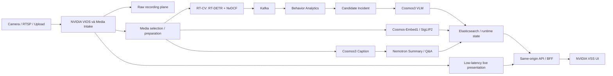

### Ranh giới dữ liệu bắt buộc

```text
Raw video storage
  -> media selection/preparation
  -> selected clip/frame/ROI
  -> AI model/VSS service
  -> metadata/event/embedding/summary/report
```

Không có đường `raw storage -> metadata/event/embedding/summary/report` trực
tiếp. Raw recording vẫn tiếp tục ngay cả khi AI bị dừng để nhường GPU.

Mọi contract liên quan phải giữ `store_id`, stable `camera_id`, UTC timestamp,
schema version, model ID/version và content hash khi có media.

## Model và NVIDIA NIM

| Vai trò | Model/runtime | Dùng để làm gì | Cách chạy hiện tại |
| --- | --- | --- | --- |
| Detector | RT-DETR Warehouse 2D v1.0.2, ResNet-50, 640×640 FP16 | Person detection, candidate input, object crop | DeepStream/TensorRT, realtime hoặc file batch |
| Tracker | NVIDIA DeepStream NvDCF | Track ID, trajectory, dwell, count, queue | Đi cùng RT-CV |
| VLM | `nvidia/cosmos3-nano-reasoner` | Alert verification, direct semantic alert, search critic, caption, visual Q&A | NVIDIA NIM/VSS RT-VLM, on-demand và serialized |
| LLM | `nvidia/nvidia-nemotron-nano-9b-v2` | Query decomposition, chat, hierarchical summary, Q&A/report reasoning | NVIDIA NIM OpenAI-compatible, on-demand |
| Video embedding | Cosmos-Embed1-448p-anomaly-detection | Text-to-video/action retrieval | VSS RT-Embedding, 768-dim, 8 frames/10 s |
| Object embedding | SigLIP2 SO400M patch16 256 | Attribute search, image search, SKU similarity baseline | FP16 TensorRT, 1152-dim |
| Retail baseline | RT-DETR + SigLIP2 + rules + Cosmos3 | Empty shelf/planogram/SKU candidate design | Chưa triển khai vì Phase 14 locked |

NIM là container serving model, không nằm “bên trong Python venv”. Model cache
được bind vào `.cache/nim/`; Python tooling dùng `.venv/`; TensorRT engines ở
`.cache/tensorrt/`.

Model/image/version/hash chi tiết: [SERVICES-AND-MODELS.md](docs/architecture/SERVICES-AND-MODELS.md)
và [model-manifest.yaml](config/models/model-manifest.yaml).

## Các pipeline chính

### 1. Camera và raw recording

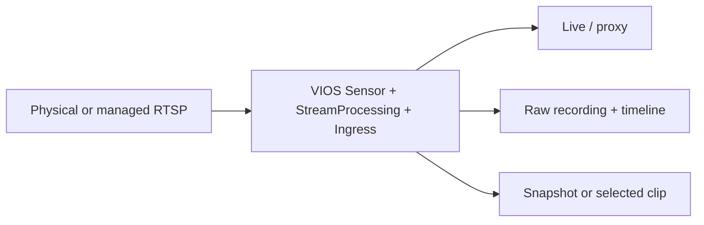

```text
Physical RTSP / managed RTSP
  -> VIOS Sensor + StreamProcessing + Ingress
  -> live/proxy + raw recording + timeline
  -> snapshot hoặc selected clip khi workflow yêu cầu
```

VIOS là chủ sở hữu video plane. AI không mount và quét toàn bộ raw archive.

### 2. Realtime RT-CV và behavior

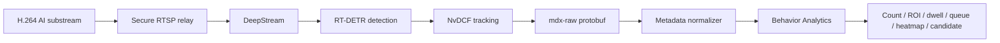

```text
AI substream
  -> secure RTSP relay
  -> DeepStream decode
  -> RT-DETR detection
  -> NvDCF tracking
  -> NVIDIA protobuf on mdx-raw
  -> normalized JSON on vss.rt-cv.frames
  -> Behavior Analytics
  -> count / line / ROI / dwell / queue / heatmap / candidate
```

### 3. Hybrid candidate → VLM alert

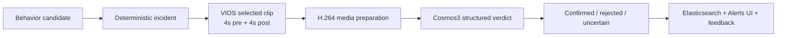

```text
Behavior candidate
  -> deterministic incident
  -> VIOS selected clip (4 s pre-roll + 4 s post-roll)
  -> H.264 1280×720 media preparation
  -> Cosmos3 structured verdict
  -> confirmed / rejected / uncertain
  -> Elasticsearch + Alerts UI + feedback
```

Đây là alert mode mặc định vì tiết kiệm GPU hơn direct RT-VLM.

### 4. Upload video → RT-CV → VLM Test

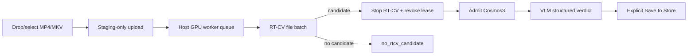

```text
Drop/select MP4/MKV
  -> staging-only upload
  -> host GPU worker queue
  -> stop conflicting GPU profile
  -> RT-CV file batch
  -> real detection candidate
  -> stop RT-CV batch
  -> admit Cosmos3
  -> VLM verdict
  -> explicit Save to Store
```

Chọn file là upload tự bắt đầu. Video không vào Store trước khi VLM hoàn tất và
người dùng bấm `Save to Store`. Nếu RT-CV không detect object, job kết thúc
`no_rtcv_candidate`; hệ thống không tạo candidate giả.

### 5. Realtime candidate → VLM Test

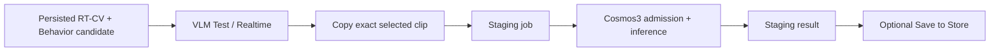

```text
RT-CV + Behavior candidate đã persist
  -> VLM Test / Realtime
  -> copy exact selected clip vào staging
  -> Cosmos3 admission/inference
  -> result trong staging
  -> optional Save to Store
```

Đây là bounded-clip realtime workflow, không phải đưa một RTSP vô hạn trực
tiếp vào VLM. Candidate mới chỉ xuất hiện khi RT-CV realtime đang healthy.

### 6. Store retest

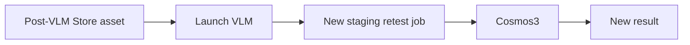

```text
Post-VLM Store asset
  -> Launch VLM
  -> staging retest job
  -> Cosmos3 result mới
```

Launch không tạo thêm một bản Store mới. Store chỉ chứa media được save rõ
ràng sau một VLM result hoàn tất.

### 7. Direct RT-VLM

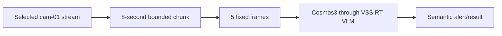

```text
Selected cam-01 stream
  -> 8-second bounded chunk
  -> 5 fixed frames
  -> Cosmos3 through VSS RT-VLM
  -> semantic alert/result
```

Mode này opt-in, giới hạn một camera và phải serialize với RT-CV.

### 8. Semantic search

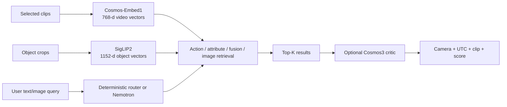

```text
Selected clips -> Cosmos-Embed1 -> 768-d video vectors
Object crops    -> SigLIP2       -> 1152-d image/object vectors
User query      -> deterministic router or Nemotron decomposition
                -> action / attribute / fusion / image retrieval
                -> optional Cosmos3 top-K critic
                -> camera + UTC + selected clip + score
```

Khi GPU providers offline, cached vectors và deterministic routing vẫn cho
phép search; critic được ghi `unavailable`, không giả kết quả verified.

### 9. Summarization, Q&A và report

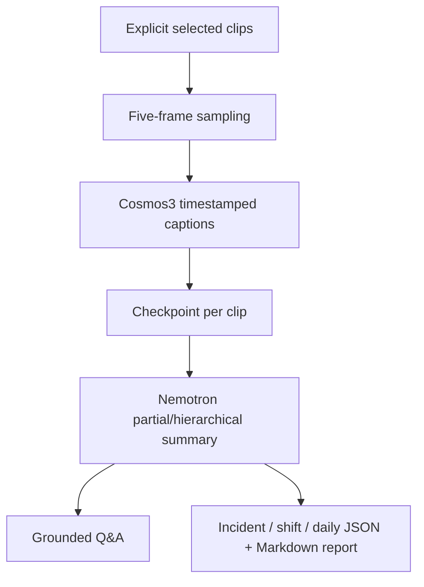

```text
Explicit selected clips
  -> five-frame sampling per clip
  -> Cosmos3 timestamped captions
  -> checkpoint after each clip
  -> Nemotron partial/hierarchical summary
  -> grounded Q&A
  -> incident / shift / daily JSON + Markdown report
```

Khoảng thời gian không có selected media là `unobserved`, không được diễn giải
thành “không có sự kiện”. Khi thiếu evidence, Q&A trả `không đủ dữ liệu`.

### 10. Chat / LLM assistant

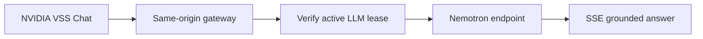

### 11. GPU model ON/OFF và admission

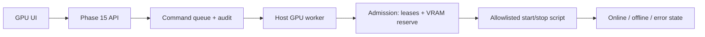

Chi tiết tất cả pipeline, failure state và nơi lưu dữ liệu:
[PIPELINES.md](docs/architecture/PIPELINES.md).

## Vai trò của Kafka, PostgreSQL và các data service

| Service | Vai trò |
| --- | --- |
| Kafka | Event bus giữa RT-CV, behavior, incident, VLM, embedding và job status; consumer group, retention và DLQ giúp retry/replay |
| Elasticsearch | Lưu/index metadata detection, behavior events, incidents, vectors, captions và summaries để truy vấn/search |
| PostgreSQL | Control-plane schema: store, camera references, config, jobs, role/audit/retention; VIOS dùng PostgreSQL riêng cho trạng thái video |
| Redis | Cache/coordination cho project; VIOS có Redis riêng cho runtime video |
| MinIO | Object/artifact store S3-compatible cho selected artifacts của PoC; không thay VIOS raw recording plane |
| VIOS | RTSP ingest, sensor/proxy, recording, playback, timeline, picture và clip selection |
| Prometheus | Thu metrics từ service, queue, API và hệ thống |
| Grafana | Dashboard quan sát metrics và operational state |
| Runtime filesystem | Persist job checkpoints, staging, selected clips, Store assets, audit và local indexes theo từng service |

Danh sách topic và flow chi tiết nằm trong
[SERVICES-AND-MODELS.md](docs/architecture/SERVICES-AND-MODELS.md).

## GPU admission và giới hạn phần cứng

GPU là **NVIDIA RTX PRO 5000 Blackwell 48 GB**, nhưng NVIDIA chưa validate GPU
này cho topology VSS hiện tại. Project chạy ở chế độ experimental
`LOCAL_SERIALIZED_WITH_UNSUPPORTED_HOST_OVERRIDE`.

Các nguyên tắc:

- RT-CV, Cosmos3, Nemotron, Cosmos-Embed1 và SigLIP2 không được tự do chạy
  cùng lúc;
- browser chỉ gửi request; host worker mới được gọi script start/stop cố định;
- mỗi transition cần admission lease và kiểm tra VRAM;
- reserve hiện tại là `5120 MiB` cho LLM/VLM;
- tắt model giữ nguyên image, cache, engine, index và dữ liệu;
- không dùng Docker prune, `down -v`, image/volume removal trong workflow.

## Các nhóm phase

| Nhóm | Phase | Nội dung | Trạng thái |
| --- | --- | --- | --- |
| Foundation | 00–05 | Scope, project isolation, host preflight, VSS release, model cache, data plane | Hoàn tất với unsupported-host risk |
| Video & realtime | 06–09 | VIOS, camera, RT-CV, scale, behavior analytics | 06/07 pass-with-risk; 08 deferred; 09 partial |
| Semantic AI | 10–13 | Hybrid VLM, direct RT-VLM, search, summary/Q&A/report | Technical paths chạy thật; accuracy vẫn partial |
| Retail AI | 14 | Empty shelf, stock visibility, planogram, SKU | Locked |
| Product surface | 15 | NVIDIA UI, same-origin API, GPU controls, VLM Test, security/audit | Partial |
| Final acceptance | 16 | Full integration, 72-hour soak, resilience, final benchmark | Chưa bắt đầu |

Xem [phase.md](phase.md) và
[PHASE-CAPABILITY-GUIDE.md](docs/PHASE-CAPABILITY-GUIDE.md).

## Cách chạy

Nếu clone project trên máy mới, đọc [SETUP.md](SETUP.md) trước. Tài liệu đó
liệt kê prerequisite, upstream VSS checkout, secret local, NIM/model cache,
thứ tự start và các bước kiểm tra. Phần dưới đây là quick reference.

### Bootstrap

```bash
make bootstrap
source scripts/env.sh
cp config/ui/vss-ui.env.example config/ui/vss-ui.env
make verify-paths
```

### Infrastructure và video plane

```bash
make infra-start
make video-start
make camera-live
```

Camera credential phải được lưu qua secret-reference workflow; không ghi RTSP
password vào repository hoặc `.env` thật.

### CPU control plane và NVIDIA VSS UI

```bash
make phase15-start
make phase15-health
```

Mở `http://127.0.0.1:39510/`.

### Realtime RT-CV

```bash
make rtcv-start
make rtcv-health
```

RT-CV cần camera secret lease hợp lệ và GPU admission. Không start RT-CV nếu
một profile GPU xung đột đang active.

### Dừng an toàn

```bash
make phase15-stop
make camera-live-stop
make video-stop
make infra-stop
```

Các lệnh stop bảo toàn images, volumes, recordings, indexes, model caches và
runtime data.

## Cấu trúc repository

```text
apps/vss-ui/             NVIDIA VSS UI provenance/integration
config/                  camera, model, analytics, prompt, runtime, security
deploy/compose/          Compose theo capability/phase
docs/                    architecture, decisions, reports, evals, runbooks, handoffs
migrations/              repeatable data-plane migrations
schemas/                 JSON Schema và OpenAPI contracts
scripts/                 safe start/stop/test/backup/admission operations
services/                project-owned adapters và workflow services
tests/                   unit/contract/regression tests
third_party/             pinned NVIDIA VSS 3.2.1 source
runtime/                 ignored persistent runtime state
artifacts/               ignored manifests, benchmark và evaluation evidence
.cache/                  ignored NIM/TensorRT/tool caches
.venv/                   project-local Python environment
```

## Tài liệu

- [Documentation index](docs/README.md)
- [Setup sau khi clone](SETUP.md)
- [Current project state](PROJECT_STATE.md)
- [Detailed pipelines](docs/architecture/PIPELINES.md)
- [Services, models and data stores](docs/architecture/SERVICES-AND-MODELS.md)
- [Phase guide](phase.md)
- [Feature matrix](docs/architecture/feature-matrix.md)
- [Architecture decisions](docs/decisions/)
- [Operational runbooks](docs/runbooks/)
- [Phase handoffs](docs/handoffs/)
- [Full phased execution plan](PLAN_NVIDIA_VSS_RETAIL_POC_1_STORE_10_CAMERAS_v2.2_PHASED.md)

## Security và giới hạn công bố

- UI/API chỉ bind loopback trong PoC hiện tại. Trusted-loopback admin không
  được expose ra LAN/Internet.
- Không commit `.env`, token, NGC key, camera password hoặc RTSP URI thật.
- RTX PRO 5000 Blackwell là topology experimental, không phải NVIDIA-validated.
- Một camera vật lý không phải bằng chứng capacity 10 camera vật lý.
- Unit mocks không phải bằng chứng model/GPU/external service đã chạy.
- Accuracy production chưa được chứng minh do evaluation set còn nhỏ.

## License và upstream

Project pin NVIDIA VSS `v3.2.1` tại commit
`7640d917047cf7b0fd3085eefb8282754b56bc94`. NVIDIA VSS UI sử dụng image tag
`3.2.0` theo đúng deployment asset của release 3.2.1; tag này là chủ ý của
upstream, không phải project tự hạ phiên bản. Kiểm tra license của từng NVIDIA
artifact/model trước khi phân phối repository hoặc image/cache.
