# Project pipeline catalog

Tài liệu này là nguồn mô tả chuẩn cho các pipeline xuyên service. Trạng thái
runtime thay đổi theo admission window; xem `PROJECT_STATE.md` để biết provider
nào đang chạy tại checkpoint mới nhất.

## Quy ước trạng thái

| Trạng thái | Ý nghĩa |
| --- | --- |
| Implemented | Code/contract và test đã tồn tại |
| Runtime proven | Đã có evidence chạy bằng service/model thật |
| Partial | Đường kỹ thuật chạy nhưng accuracy/scale/integration chưa đủ |
| On-demand | Provider chỉ chạy khi có admission lease |
| Deferred | Chưa làm theo quyết định thứ tự/phạm vi |
| Locked | Không được triển khai khi chưa có input/approval |

## 1. Source onboarding và video plane

### 1.1 Physical camera

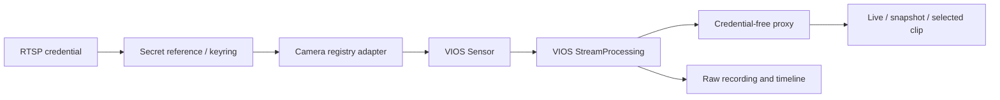

1. Operator lưu URI bằng secret workflow; committed config chỉ chứa
   `camera://...` reference.
2. Registry giữ stable `camera_id=cam-01`, `store_id=store-001` và mô tả
   main/AI stream.
3. VIOS đăng ký sensor/proxy và tự quản lý recording/timeline.
4. Browser và AI consumer chỉ nhận same-origin presentation URL hoặc
   credential-free internal relay.

Failure states: secret missing, RTSP authentication failure, codec/decode
failure, sensor offline, timeline chưa có recording. Không failure nào được
che bằng mock stream.

### 1.2 User-managed RTSP stream

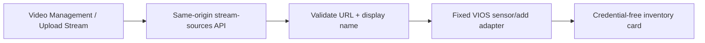

```text
Video Management / + Upload Stream
  -> same-origin POST /workspace/stream-sources
  -> validate rtsp:// URL and display name
  -> fixed VIOS sensor/add upstream
  -> credential-free inventory card
```

Delete từ NVIDIA UI gọi compatibility route theo display name. Gateway resolve
tên về stable VIOS source ID rồi dùng guarded delete. Stable `cam-01` có
`can_delete=false`; stream user-added mới có thể xóa.

Credential chỉ được chuyển đến fixed VIOS adapter. Inventory, audit và browser
response không trả lại URI hoặc password.

### 1.3 Raw storage boundary

Raw recording thuộc VIOS/video plane. AI historical workflow chỉ được phép:

```text
VIOS timeline
  -> select exact camera/time
  -> materialize bounded clip/frame/ROI
  -> validate/hash/prepare
  -> AI service
```

Không service AI nào được mount raw recording để quét archive.

## 2. Low-latency live presentation

```mermaid
flowchart LR
    PROXY[cam-01 VIOS proxy] --> GST[GStreamer RTSP TCP<br/>100ms jitter buffer]
    GST --> QUEUE[Leaky queue<br/>2 frames]
    QUEUE --> JPEG[NVJPEG multipart MJPEG]
    JPEG --> ENDPOINT[/cam-01/live.mjpeg]
    ENDPOINT --> UI[Streaming card / Open Live]
```

```text
cam-01 VIOS proxy
  -> GStreamer rtspsrc TCP
     latency=100 ms
     drop-on-latency=true
     buffer-mode=none
  -> leaky queue (2 frames)
  -> NVJPEG multipart MJPEG
  -> /workspace/cameras/cam-01/live.mjpeg
  -> Streaming card / Open Live
```

Leaky queue bỏ frame cũ khi client chậm, tránh tích lũy 1–2 phút backlog.
Presentation là low-latency best effort, không phải zero-latency guarantee.

AI overlay lấy MJPEG và metadata qua hai đường độc lập. Vì vậy live video vẫn
có thể chạy khi RT-CV offline; bounding box lúc đó phải chuyển sang trạng thái
reconnecting/unavailable thay vì giữ box vô hạn.

## 3. Realtime RT-CV

Trạng thái: implemented và runtime proven cho một physical `cam-01`; chưa có
10-physical-camera capacity evidence.

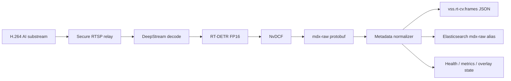

Contract output có:

- stable `store_id` và `camera_id`;
- frame UTC timestamp;
- detector/tracker model version;
- bounding box, class, confidence và track ID;
- schema version và correlation/event fields.

RT-CV metadata là object-driven. Không có detection trong cảnh trống không có
nghĩa stream đã chết; health còn dùng vendor FPS/frame counter.

## 4. RT-CV file batch

Trạng thái: runtime proven trong VLM Test upload workflow.

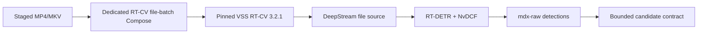

```text
staged MP4/MKV
  -> dedicated rtcv-file-batch Compose
  -> pinned VSS RT-CV image
  -> DeepStream file source
  -> mdx-raw detections
  -> bounded candidate contract
```

File batch có lease `rtcv_file_batch`. Nó chỉ tạo candidate khi RT-CV thật
phát hiện object. Kết quả `no_rtcv_candidate` là trạng thái hợp lệ. Khi batch
xong, container/lease được dừng trước khi Cosmos3 được admit.

## 5. Behavior analytics

Trạng thái: implemented/runtime proven; accuracy real-camera vẫn partial.

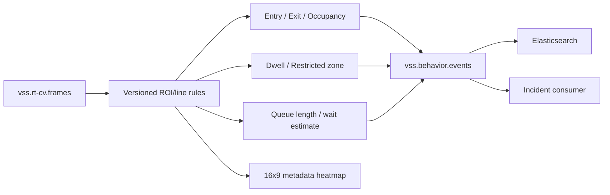

Heatmap chỉ lưu normalized metadata count, không lưu frame. Synthetic events
được gắn `evaluation=true` và không được dùng làm production evidence.

## 6. Hybrid candidate incident → Cosmos3 verification

Trạng thái: default alert policy; runtime proven, accuracy partial.

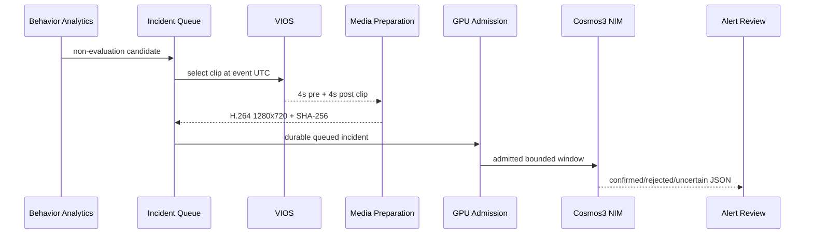

Các bước bảo vệ:

1. deterministic incident ID và idempotent persistence;
2. selected clip thay vì raw archive;
3. clip normalization vì Cosmos3 giới hạn dimension decoder;
4. structured verdict validation;
5. transient retry; exhausted failure thành `uncertain` và DLQ;
6. feedback label dùng cho confusion matrix;
7. incident/clip không bị mất khi VLM offline.

## 7. Direct RT-VLM

Trạng thái: opt-in, one-camera runtime proven, accuracy partial.

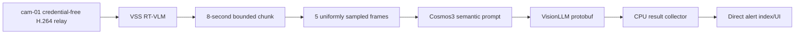

```text
cam-01 credential-free H.264 relay
  -> VSS RT-VLM
  -> 8-second chunk
  -> 5 uniformly fixed frames
  -> Cosmos3 semantic prompt
  -> VisionLLM protobuf
  -> CPU result collector
  -> direct alert index/UI
```

Direct mode không consume RT-CV metadata hoặc behavior candidate. Nó phù hợp
semantic use case khó viết rule nhưng tốn GPU hơn hybrid. Chính sách hiện tại:
hybrid mặc định, direct chỉ explicit start và tối đa một camera.

## 8. VLM Test — Upload

Trạng thái: implemented/runtime proven.

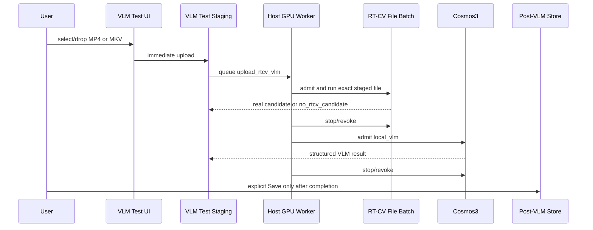

Storage states:

- `staging_only`: uploaded/test media chưa vào Store;
- VLM result complete: vẫn staging;
- explicit `Save to Store`: tạo post-VLM Store asset;
- cancel/remove staging: không phải xóa VIOS raw archive.

Một job có candidate nhưng VLM admission fail giữ trạng thái
`waiting_for_gpu`; Retry VLM vẫn phải qua host worker.

## 9. VLM Test — Realtime candidate

Trạng thái: implemented; phụ thuộc candidate đã persist.

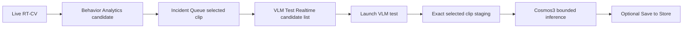

```text
live RT-CV
  -> Behavior Analytics candidate
  -> Incident Queue selected clip
  -> VLM Test / Realtime candidate list
  -> Launch VLM test
  -> copy exact selected clip to staging
  -> Cosmos3 bounded inference
  -> optional Save to Store
```

Không thể đảm bảo “zero-delay VLM” vì:

- candidate cần đủ event context và post-roll;
- Cosmos3 cần finite clip/frame set, không nhận stream vô hạn trong workflow này;
- RT-CV và Cosmos3 phải serialized trên một GPU;
- model admission/startup/inference đều có latency.

Target thực tế là bounded 8–10 second evidence window cộng model admission và
inference latency. Nếu RT-CV realtime unavailable, candidate cũ vẫn retest
được nhưng candidate mới không xuất hiện.

## 10. VLM Test — Store retest

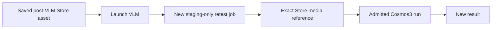

```text
Store asset saved after completed VLM
  -> Launch VLM
  -> new staging-only job referencing exact Store media
  -> admitted Cosmos3 run
  -> new result
```

Retest không duplicate Store asset. Muốn lưu một kết quả/media version khác
phải qua explicit Save contract.

## 11. Media intake cho Summary

Đây là plane khác VLM Test Store.

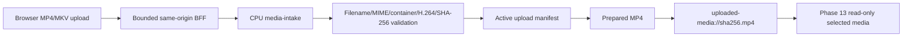

```text
browser MP4/MKV upload
  -> bounded same-origin BFF
  -> CPU media-intake
  -> filename/MIME/container/H.264/SHA-256 validation
  -> active upload manifest
  -> prepared MP4
  -> uploaded-media://<sha256>.mp4
  -> Phase 13 read-only selected media
```

MKV hợp lệ có thể được catalog nhưng `summary_ready=false` nếu chưa có remux
binary được duyệt. Delete là quarantine có restore, không phải physical purge.

## 12. Video/action và object embedding

Trạng thái: runtime proven trên bounded evaluation set.

### Video/action

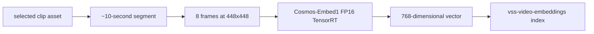

```text
selected-clip:// asset
  -> segment ~10 seconds
  -> sample 8 frames at 448x448
  -> Cosmos-Embed1 FP16 TensorRT
  -> 768-dimensional vector
  -> vss-video-embeddings index
```

### Object/image


```text
selected-snapshot/object crop
  -> SigLIP2 256x256 FP16 TensorRT
  -> 1152-dimensional vector
  -> object embedding index
```

Đổi model/version/vector dimension bắt buộc đổi generation và re-index.

## 13. Search query

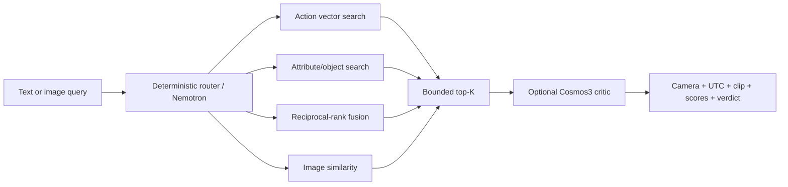

Graceful degradation:

- Nemotron offline → deterministic query router;
- Cosmos3 critic offline → giữ ranked results và ghi `critic_status=unavailable`;
- provider online nhưng output không hợp lệ → không relabel result thành verified.

## 14. Caption, summary, Q&A và reporting

Trạng thái: runtime proven, quality evaluation partial.

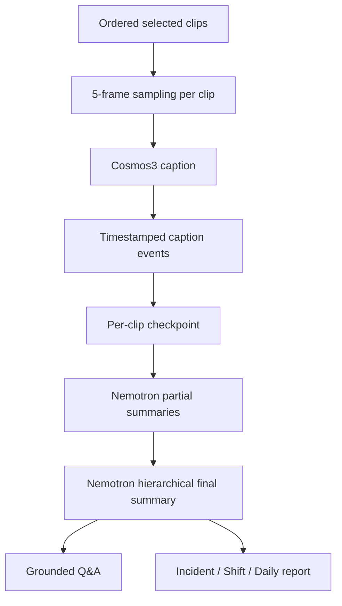

Job states cho phép restart/resume mà không caption lại clip đã checkpoint.
Final summary chỉ nhận grounded partials và allowlisted event IDs. Q&A filter
theo exact camera/time; không evidence thì refusal. Report giữ selected media,
UTC, model/prompt version và explicit `unobserved` gaps.

## 15. Chat / LLM assistant

```mermaid
flowchart LR
    CHAT[NVIDIA VSS Chat drawer] --> ENDPOINT[/compat/chat/stream]
    ENDPOINT --> BFF[Same-origin gateway]
    BFF --> LEASE[Verify active LLM lease]
    LEASE --> LLM[Fixed Nemotron endpoint]
    LLM --> CLEAN[Strip reasoning delimiters]
    CLEAN --> SSE[SSE answer]
```

```text
NVIDIA VSS Chat drawer
  -> /compat/chat/stream
  -> same-origin gateway
  -> verify active LLM lease
  -> fixed Nemotron endpoint 127.0.0.1:30081
  -> strip reasoning delimiters
  -> SSE answer
```

Browser-supplied provider URL bị bỏ qua. Chat không tự bật LLM. Khi LLM
offline, UI phải hiển thị standby/capability guidance thay vì fake answer.

## 16. GPU model ON/OFF và admission

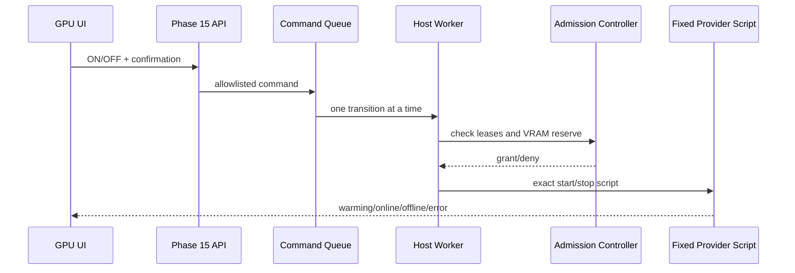

ON/OFF không xóa image/cache/model/engine/data. Unknown lease fail-closed.
Project LLM và VLM mutual-exclusive; current reserve là 5 GiB.

## 17. Observability và audit

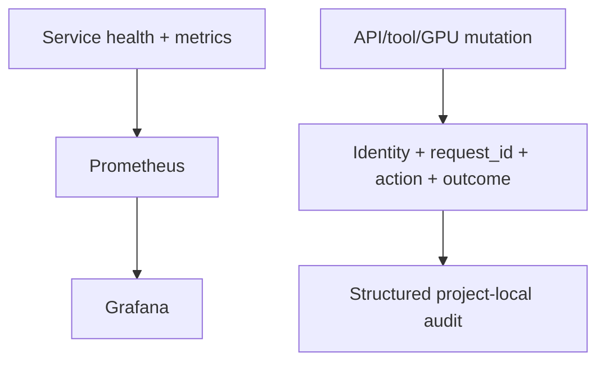

```text
service health/metrics
  -> Prometheus
  -> Grafana

mutating API/tool/GPU action
  -> identity + request_id + action + outcome
  -> structured project-local audit
```

Logs không được chứa RTSP credential, NGC key, bearer token hoặc raw cookies.
Kafka lag, DLQ size, GPU/VRAM, model readiness, stream state, inference latency
và job age là các tín hiệu vận hành chính.

## 18. Retail AI target pipeline

Trạng thái: **Locked, chưa implemented**.

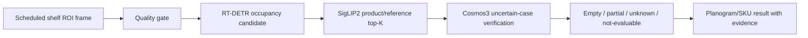

```text
scheduled shelf ROI frame
  -> quality gate
  -> RT-DETR / occupancy candidate
  -> SigLIP2 product/reference top-K
  -> Cosmos3 uncertain-case verification
  -> empty/partial/unknown/not-evaluable
  -> planogram/SKU result with evidence
```

Pipeline chỉ được mở khi có shelf ROI, product master, reference image,
annotation/evaluation policy và user approval. Camera output là visual
visibility, không phải official inventory.

## 19. Failure and recovery principles

- Video plane tiếp tục khi AI dừng.
- Candidate/job phải persist trước GPU work.
- Provider offline giữ queued/standby state.
- Structured output sai schema không được coi là success.
- DLQ giữ failure để replay có kiểm soát.
- Stop scripts bảo toàn image, volume, model, cache và runtime data.
- Mocks chỉ dùng unit test, không dùng làm runtime/model evidence.
