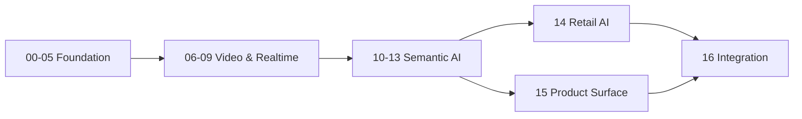

# Project phases

Tài liệu này giải thích roadmap theo nhóm dễ đọc. Trạng thái chính thức tại
thời điểm hiện tại nằm trong `PROJECT_STATE.md`; execution contract đầy đủ nằm
trong phased plan gốc.

## Tổng quan

| Nhóm | Phase | Kết quả mong muốn | Current status |
| --- | --- | --- | --- |
| Foundation | 00–05 | Architecture, project isolation, host/VSS/model/data plane | Complete with risk |
| Video & Realtime | 06–09 | VIOS, camera, RT-CV, scale, behavior | Mixed; Phase 08 deferred |
| Semantic AI | 10–13 | Hybrid/direct VLM, search, summary/Q&A/report | Technical paths proven, evaluation partial |
| Retail AI | 14 | Shelf/stock/planogram/SKU | Locked |
| Product Surface | 15 | NVIDIA UI, API/BFF, GPU controls, audit, VLM Test | Partial/current |
| Integration | 16 | Full E2E, resilience, 72-hour soak and final report | Not started |

## Group A — Foundation (Phase 00–05)

### Phase 00 — Scope and architecture

Khóa phạm vi một store/khoảng 10 camera, stable identity fields, VSS 3.2.1,
video/AI plane boundary, no-prune/no-secret policy và serialized single-GPU
topology.

Status: `PASS`.

### Phase 01 — Project-local bootstrap

Tạo `.venv`, `.cache`, `runtime`, `artifacts`, scripts, Makefile và path guard.
Dependency/tool/model cache không được tự rơi ra global host path.

Status: `PASS`.

### Phase 02 — Host/GPU preflight

Inventory OS, GPU, driver, Docker/Compose, CDI, RAM/disk/network và container
GPU access.

Status: `PASS_WITH_RISK` vì host không khớp NVIDIA prerequisite baseline.

### Phase 03 — VSS release assets

Pin NVIDIA VSS 3.2.1 source, release compose/image references và digests.
Image UI mang tag 3.2.0 theo upstream release asset là hợp lệ.

Status: `PASS_WITH_RISK`.

### Phase 04 — Models/NIM/cache

Discover/cache/smoke test Nemotron, Cosmos3, RT-DETR, Cosmos-Embed1 và
SigLIP2. Build/persist TensorRT engines và record hashes/profile IDs.

Status: `PASS_WITH_RISK`; local serialized topology only.

### Phase 05 — Infrastructure data plane

Dựng Kafka, Elasticsearch, PostgreSQL, Redis, MinIO, Prometheus, Grafana,
migration và backup/restore.

Status: `PASS`. Phase này được thực hiện trước 00–04 theo yêu cầu người dùng;
ngoại lệ thứ tự không thay đổi architecture gates.

## Group B — Video and Realtime (Phase 06–09)

### Phase 06 — Video Management

VIOS quản lý RTSP sensor/proxy, recording, playback, timeline, snapshot,
selected clip và reconnect. Camera secret chỉ tồn tại dưới secret reference.

Status: `PASS_WITH_RISK`. Hiện registry mặc định chỉ công bố physical
`cam-01`; replay assets được giữ để phục hồi/test lịch sử.

### Phase 07 — One-camera RT-CV

Physical AI substream → secure relay → DeepStream → RT-DETR → NvDCF → Kafka →
normalized metadata/Elasticsearch/overlay.

Status: `PASS_WITH_RISK` cho vertical slice và 7,227-second soak lịch sử.
RT-CV realtime tại checkpoint mới nhất đang `unavailable`, nên runtime health
khác với historical phase evidence.

### Phase 08 — Ten-camera scale

Benchmark 1/2/4/6/8/10 physical streams, FPS, latency, drops, GPU/VRAM/NVDEC,
reconnect và soak.

Status: `DEFERRED_BY_USER`. Replay sources không được dùng để đóng capacity
gate cho 10 camera vật lý.

### Phase 09 — Behavior Analytics

Line crossing, entry/exit, occupancy, dwell, restricted zone, queue, wait
estimate, heatmap và candidate event dựa trên RT-CV metadata.

Status: `PARTIAL`: technical pipeline pass, real-camera ROI/ground-truth
accuracy chưa đủ.

## Group C — Semantic AI (Phase 10–13)

### Phase 10 — Hybrid alert verification

Behavior candidate → deterministic incident → VIOS selected clip → media
preparation → admitted Cosmos3 → confirmed/rejected/uncertain → review/DLQ.

Status: `PARTIAL`: real inference pass, feedback/evaluation set nhỏ. Đây là
default alert policy.

### Phase 11 — Direct RT-VLM

Selected stream → bounded 8-second chunk/5 frames → VSS RT-VLM + Cosmos3 →
semantic alert collector.

Status: `PARTIAL`: real runs pass, accuracy labels thiếu. Opt-in, one camera.

### Phase 12 — Embedding and search

Cosmos-Embed1 video vectors, SigLIP2 object vectors, action/attribute/fusion/
image search, optional Nemotron decomposition và Cosmos3 top-K critic.

Status: `PARTIAL`: all technical routes proven on a small selected dataset.

### Phase 13 — Summarization, Q&A and reporting

Selected clips → Cosmos3 captions/checkpoints → Nemotron hierarchical summary
→ grounded/refused Q&A → incident/shift/daily JSON/Markdown reports.

Status: `PARTIAL`, nhưng là last approved phase. Technical checkpoint/restart
and evidence behavior pass; human quality evaluation thiếu.

## Group D — Retail AI (Phase 14)

Target: scheduled shelf ROI, image quality gate, empty shelf, visual stock,
planogram và SKU retrieval/verification.

Status: `LOCKED_BY_USER`. Không có approved shelf ROI, product master,
reference images hoặc dataset. Không mock capability để đánh dấu complete.

## Group E — Unified Product Surface (Phase 15)

NVIDIA VSS UI, same-origin gateway/BFF, Search/Alerts/Video Management/Chat,
GPU LLM/VLM controls, VLM Test Upload/Realtime/Store, RBAC/audit, service
registry, backup/restore và runbooks.

Status: `PARTIAL`.

Current additions:

- upstream NVIDIA VSS UI pinned from VSS 3.2.1;
- `+ Upload Stream`, guarded delete and low-latency live;
- Streaming/VLM Processed Videos single-pane UI;
- automatic upload → RT-CV batch → candidate → VLM;
- explicit Save to post-VLM Store and Store retest;
- model ON/OFF through host worker and 5 GiB reserve.

Open gates: RT-CV realtime recovery, browser/accessibility matrix, safe
Prometheus host-loopback scrape, production TLS/IdP, traces/DCGM and Phase 14
tool absence.

## Group F — Final Integration (Phase 16)

Full E2E feature matrix, failure injection, 72-hour soak, capacity, model
evaluation, security, backup/restore, pilot sizing and final PoC reports.

Status: `NOT_STARTED`. Không được bắt đầu hoặc đánh dấu acceptance khi Phase
08/14/15 blockers chưa được xử lý/waive rõ ràng.

## Dependency rules

- Raw storage chỉ đi vào AI qua media selection/preparation.
- Phase 10–13 dùng exact selected media; không scan raw archive.
- GPU providers phải được admit, serialized và bounded.
- Phase status kỹ thuật không đồng nghĩa production accuracy.
- Historical phase PASS không đồng nghĩa service đang healthy ở current
  runtime checkpoint.

## References

- Current truth: [PROJECT_STATE.md](PROJECT_STATE.md)
- Full pipelines: [PIPELINES.md](docs/architecture/PIPELINES.md)
- Service/model map: [SERVICES-AND-MODELS.md](docs/architecture/SERVICES-AND-MODELS.md)
- Full execution plan: [phased plan](PLAN_NVIDIA_VSS_RETAIL_POC_1_STORE_10_CAMERAS_v2.2_PHASED.md)
- Detailed evidence: [phase handoffs](docs/handoffs/)
